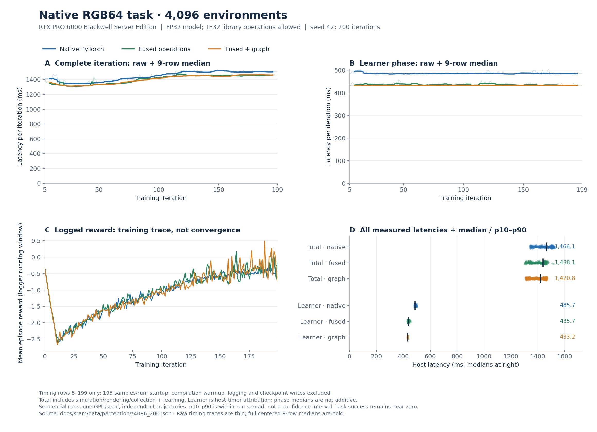
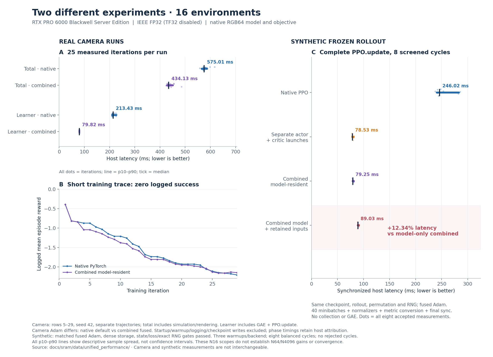
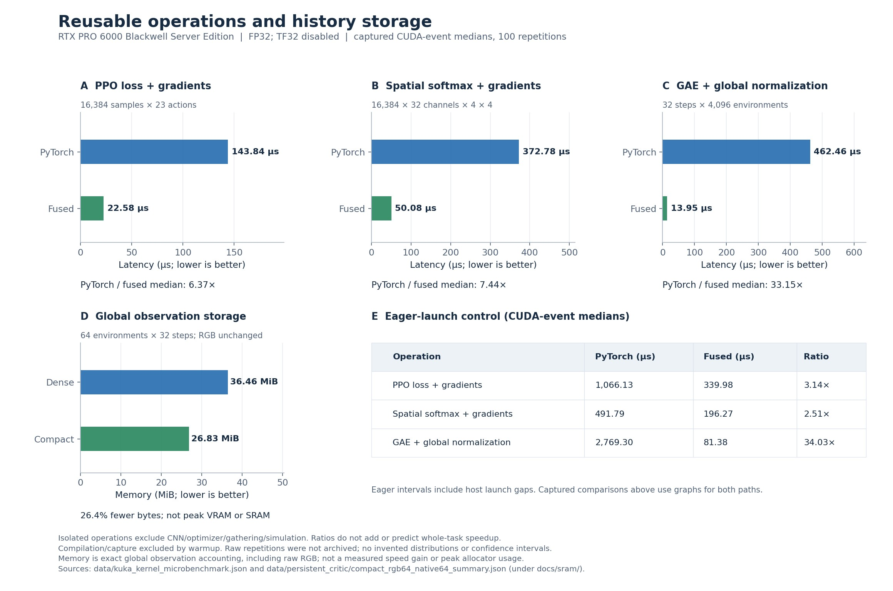

# Performance results, MDP2, and reuse across tasks

Measured implementation: [`52bca3a5e`](https://github.com/rubendsa/IsaacLab/commit/52bca3a5e07d24f7034a482d74838d7210ff2bb1),
branch `sram-resident-training`, based on Isaac Lab v3.0.0. Assessment: 2026-11-22.
This report consolidates existing measurements; it does not introduce new GPU benchmark runs.

**The strongest candidate for broad reuse is selective PPO fusion.** At 4,096 environments it improved
learning-phase throughput by 11.5%, while keeping the native CNN and matrix multiplications in their existing
libraries. Complete training iterations improved by 1.9% in those runs. The larger 2.67× learning-phase result
at 16 environments comes from a specialized persistent learner and has much narrower applicability.
Neither result yet establishes a speedup across tasks, GPUs, or time to task success.

**The measured branch does not use MDP2.** MDP2 targets environment stepping, while this work primarily targets
PPO updates. Combining the reusable parts is a sensible next experiment, but the combination has not been
implemented or measured. Pure Warp is a separate, numerically checked encoder prototype with no speed result.

## What the measurements show

All learner results below use an RTX PRO 6000 Blackwell Server Edition with 188 SMs. Ratios compare median
latencies within each experiment. A throughput ratio of 1.115× means 11.5% more work per second, not an 11.5%
latency reduction. Plotted percentile ranges describe observed iterations or samples; they are not confidence
intervals over independent training runs.

### Native-scale camera training: reusable fusion helps, collection still dominates

The workload is `Isaac-Lift-KukaAllegro-Camera`, `single_camera,rgb64`, Newton/MJWarp physics and Newton rendering.
It retains the native trainable CNN, 23-action Gaussian policy, critic, observation normalizers, 32-step rollout,
and five epochs of eight minibatches. These measurements use the native TF32-enabled library math.

| Backend, 4,096 environments | Learning median | Complete iteration median | Learning throughput | Iteration throughput |
| --- | ---: | ---: | ---: | ---: |
| Native PyTorch | 485.66 ms | 1,466.05 ms | 1.000× | 1.000× |
| Selective fusion | 435.70 ms | 1,438.14 ms | 1.115× | 1.019× |
| Selective fusion + CUDA graph | 433.15 ms | 1,420.78 ms | 1.121× | 1.032× |



*Figure 1. Each backend ran 200 training iterations with seed 42; timing summaries exclude the first five.
The reward traces describe training behavior, not held-out evaluation. Separate trajectories and fixed run
order limit causal interpretation of the small complete-iteration differences.*

The selective implementation combines GPU metric accumulation, fused Adam, fused PPO loss and backward,
fused GAE with advantage normalization, and fused spatial softmax. The experiment measures that bundle;
it does not attribute the 11.5% improvement to individual changes. The extra graph reduces learning time only
another 2.55 ms at this scale. The graph version also omits native PPO's discarded optimization-time action
samples, changing subsequent RNG state.

About a second per iteration remains in collection, including policy inference, physics, rendering and
environment bookkeeping. Faster loss kernels alone cannot remove that cost. The phase timings use native host
attribution; full iterations are measured directly. Independently computed collection and learning medians
must not be added to reconstruct a total.

The three runs have finite losses, changed CNN weights and passing integration checks, but their maximum
logged training success remains below 0.011%. They establish bounded throughput, not solved-task performance.
[Raw runs and comparison](data/perception/README.md), [comparison summary](data/perception/comparison_4096_200.json).

### Small batches: persistence helps, additional residency does not always help

At 16 environments, the combined persistent learner retains both native networks' weights and Adam state
through their optimizer updates. These experiments use IEEE FP32 with TF32 disabled. Their baseline, precision,
batch size and timing boundaries differ from Figure 1. The real-camera comparison includes the change from
native default Adam to the persistent backend's fused-Adam-equivalent math; the separate synthetic comparison
matches fused Adam on both sides.

| Real RGB64 camera training, 16 environments | Native | Combined persistent | Throughput ratio |
| --- | ---: | ---: | ---: |
| Learning, including GAE and PPO update | 213.43 ms | 79.82 ms | 2.674× |
| Complete iteration | 575.01 ms | 434.13 ms | 1.324× |



*Figure 2. Real camera runs contain 25 timed iterations after five warmups, one seed and separate trajectories.
The synthetic panel is a different experiment: eight balanced cycles over four backends, with identical input
rollouts, restored checkpoints and restored entry RNG state. Its timing excludes environment collection and GAE.*

The synthetic experiment includes all 40 actor/critic optimizer steps, normalizer updates, metric transfer,
native-equivalent RNG consumption, wrapper packing and state copy-back. It compares against native PPO using
the same fused Adam implementation:

| Complete synthetic PPO update, 16 environments | Median | Throughput relative to native |
| --- | ---: | ---: |
| Native PPO + fused Adam | 246.02 ms | 1.000× |
| Separate persistent actor and critic | 78.53 ms | 3.133× |
| Combined persistent actor and critic | 79.25 ms | 3.105× |
| Combined models + resident rollout inputs | 89.03 ms | 2.763× |

All 32 synthetic state/loss/RNG checks passed; the maximum reported state difference was 1.86e-8. Combining
the two persistent launches brought no measured benefit, and keeping more inputs resident made the update
**12.34% slower** than the combined model-only backend. At 64 environments, the separately measured persistent
visual actor was also slower than its native counterpart: 245.00 versus 177.06 ms. The critic was faster,
34.89 versus 84.31 ms; those separate component timings are not a complete-iteration comparison.

The practical lesson is to minimize measured execution time, rather than maximize the amount of state called
resident. Occupancy, synchronization, reductions and data movement can outweigh saved loads. These kernels
specialize the native network, update schedule and 188-SM device; the combined backends currently accept at
most 16 environments. [N16 evidence and audits](data/unified_performance/README.md),
[persistent component measurements](SRAM_TRAINING.md#native-actor-comparison).

### The operations worth extracting



*Figure 3. Operation timings exclude CNN/GEMM, minibatch gathering, Adam, simulation and rendering. The
captured comparisons replay both reference and fused operations in CUDA graphs. Memory accounting is a
separate measurement; reduced storage does not establish reduced latency.*

The captured median improvements are 6.37× for PPO loss forward/backward at batch 16,384 and 23 actions,
33.15× for GAE and normalization over 32 × 4,096 transitions, and 7.44× for spatial-softmax forward/backward
over 16,384 × 32 × 4 × 4 features. These are operation-level improvements, not multiplicative factors for
complete training. [Microbenchmark data](data/kuka_kernel_microbenchmark.json).

The loss and GAE kernels operate on variable tensor shapes without the persistent learner's 188-SM
restriction. They still require supported FP32 CUDA layouts and matching PPO semantics. Spatial softmax
applies only to encoders using that operation. Lossless history compaction addresses a different bottleneck:
at 64 environments, retained observation storage fell from 36.46 to 26.83 MiB, a 26.4% reduction, while RGB
storage stayed at 24 MiB. It reconstructs native histories for minibatches and has no measured speedup.
[History accounting](data/persistent_critic/compact_rgb64_native64_summary.json).

## How this relates to MDP2

The training branch is based on v3.0.0 commit `e3f7d9ff1`. MDP2 merged into main later, on November 19 UTC, as
[`c518b272e`, PR #9016](https://github.com/isaac-sim/IsaacLab/pull/9016). That commit is not an ancestor of
the measured SRAM implementation, and the tree contains no MDP2 source. The
[training driver](../../scripts/sram/train_kuka_perception.py) selects the ordinary camera task, whose
[registration](../../source/isaaclab_tasks/isaaclab_tasks/core/lift/config/kuka_allegro/__init__.py)
uses `ManagerBasedRLEnv`. Shared Newton/Warp infrastructure does not constitute direct MDP2 reuse.

MDP2 compiles observation, reward, termination, command, event and action terms into dependency-aware fused
Warp kernels. It captures the control step, including physics and masked resets, in CUDA graphs and keeps
episode accounting on device. Its Gym/Torch boundary supports an ordinary RSL-RL learner.
The relevant version here is main `5d8cde933f80`, used by the separate single-environment investigation:
[MDP2 design](https://github.com/isaac-sim/IsaacLab/blob/5d8cde933f80ecb128b24541192af715c2e30c63/docs/source/experimental-features/mdp2.rst),
[fusion compiler](https://github.com/isaac-sim/IsaacLab/blob/5d8cde933f80ecb128b24541192af715c2e30c63/source/isaaclab_experimental/isaaclab_experimental/mdp2/fusion.py),
[environment runtime](https://github.com/isaac-sim/IsaacLab/blob/5d8cde933f80ecb128b24541192af715c2e30c63/source/isaaclab_experimental/isaaclab_experimental/envs/mdp2_env.py).

The [upstream PR](https://github.com/isaac-sim/IsaacLab/pull/9016) also reports full RSL-RL training gains at
4,096 environments on this GPU family: 1.24× for Cartpole, 1.36× for Go2 flat and 1.27× for state Kuka lift.
Those are upstream, single-seed `runner.learn` wall-time results with matching native task/runner settings,
not an independent rerun here and not a combined MDP2/optimized-learner result. They provide more relevant
training-scale evidence for adopting MDP2 than the single-environment timings alone.

The earlier single-environment investigation measured the following stepping results on that main revision:

| Task | Ordinary environment, real-time factor | MDP2, real-time factor | Environment throughput ratio |
| --- | ---: | ---: | ---: |
| Cartpole | 22.29× | 37.08× | 1.66× |
| Go2 flat | 6.45× | 10.01× | 1.55× |
| Kuka-Allegro state lift | 5.36× | 9.30× | 1.74× |

Real-time factor is simulated seconds per wall second: **9.30× real time is not a 9.30× speedup over stock**.
These are headless, one-environment, zero-action stepping measurements with no camera or learner. Each run
uses the median of three 500-step windows synchronized at the window end; the table takes medians over
three ordinary and two MDP2 runs per task. Run trajectories differ, and telemetry was sampled before/after,
without continuous interference screening. These results motivate integration but do not predict RGB
training gains. The [raw-record extraction](data/mdp2_step_comparison.json) preserves selected records,
source-file and record hashes, exact ratios, configuration and limitations.

| Layer | Existing work | Reuse opportunity |
| --- | --- | --- |
| Environment control step | MDP2 fuses task terms and captures physics/reset execution | Use its compiler/runtime for supported tasks |
| Rollout storage | Lossless processed-frame history compaction | Add a layout adapter for MDP2 observations |
| PPO update | GPU metrics, fused Adam, PPO loss and GAE | Port independent operations behind the existing RSL-RL boundary |
| Perception encoder | Fused spatial softmax; experimental pure-Warp encoder | Use spatial fusion where the architecture matches; benchmark Warp separately |
| Persistent full learner | Specialized CUDA actor/critic kernels | Retain as a small-batch experiment until other shapes and devices justify it |

There are concrete integration differences to resolve. The current MDP2 Kuka lift uses state/point-cloud
observations and MLPs, with adaptive learning rate and five epochs of four minibatches; the measured RGB task
uses a CNN, fixed learning rate and five epochs of eight minibatches. The current selective PPO class rejects
adaptive schedules, so it is not a drop-in replacement for that MDP2 agent.
[MDP2 task](https://github.com/isaac-sim/IsaacLab/blob/5d8cde933f80ecb128b24541192af715c2e30c63/source/isaaclab_tasks/isaaclab_tasks/mdp2/lift_kuka_allegro/lift_env_cfg.py),
[MDP2 agent](https://github.com/isaac-sim/IsaacLab/blob/5d8cde933f80ecb128b24541192af715c2e30c63/source/isaaclab_tasks/isaaclab_tasks/mdp2/lift_kuka_allegro/agents/rsl_rl_ppo_cfg.py).

RGB integration needs an explicit camera bridge. MDP2 renders after resets, outside capture; the ordinary
camera environment renders during decimation before resets. Image timestamps, terminal observations and
history/reset timing must be reconciled. History compaction currently discovers an `ObservationManager`
layout, while MDP2 has no such manager. These are compatibility requirements, not demonstrated failures of
the approach.

## Applying the learnings to other tasks

The portable strategy is to extract individual operations into the ordinary learner and preserve each task's
recipe. Changing a task to fixed learning rate simply to fit the current wrapper would confound a performance
comparison. The current
[backend guards](../../source/isaaclab_sram/isaaclab_sram/perception.py)
also reject recurrent models, mixed precision, multi-GPU, RND, symmetry, non-Gaussian actions, non-Adam
optimizers, per-minibatch advantage normalization and unclipped value loss.

| Target | First change to try | Additional candidates | Work required before claiming support |
| --- | --- | --- | --- |
| Go2 flat/rough locomotion | GPU logging metrics and fused Adam in native PPO | Fused GAE/PPO; MDP2 for its available flat task | Preserve adaptive KL learning-rate decisions and native rollout semantics; no spatial-softmax benefit for state MLPs |
| Franka reach and state Kuka lift | Same small PPO changes | Fused GAE/PPO; history compaction where histories repeat | Preserve adaptive schedules and task-specific observation layouts; validate checkpoint resume |
| Kuka RGB64 camera | Existing selective backend is the measured starting point | Spatial softmax; compact histories; graphs if profiling supports them | Other environment counts and devices need measurement; convergence remains unproven |
| Kuka depth64 camera | Selective operations compatible with the camera recipe | Spatial softmax and history compaction | Run depth-specific numerical and training checks; RGB-specialized persistent kernels do not establish depth support |
| MDP2 state/point-cloud tasks | Native RSL-RL plus GPU metrics and fused Adam | Fused GAE/PPO; compact storage adapter | Integrate on MDP2-capable main, preserve adaptive schedules, and measure environment and learner together |
| Recurrent, mixed-precision, distributed, RND or symmetry recipes | Port only independently valid logging/optimizer changes | Dedicated kernels after correctness coverage | Sequence masks, autocast/overflow behavior, reductions and augmented losses require explicit support; the current backend rejects these recipes |

Start with Go2 flat and Franka reach to test different state-only workloads, then depth64 to test a second
perception modality. Use MDP2 Go2 flat as the first environment/learner integration case because an MDP2 task
already exists; defer the RGB bridge until state-task integration is correct. Preserve each target's native
model, observation preprocessing, optimizer settings and training schedule.

Use the actual registered tasks and their native agent configurations:

- `Isaac-Velocity-Flat-UnitreeGo2` and `Isaac-Velocity-Rough-UnitreeGo2` use a 24-step rollout and 5 × 4 updates,
  with different MLP widths. [Go2 agent recipes](../../source/isaaclab_tasks/isaaclab_tasks/core/velocity/config/go2/agents/rsl_rl_ppo_cfg.py).
- `Isaac-Reach-Franka` uses a 24-step rollout and **8 × 4** updates.
  [Franka recipe](../../source/isaaclab_tasks/isaaclab_tasks/core/reach/config/franka/agents/rsl_rl_ppo_cfg.py).
- `Isaac-Lift-KukaAllegro` uses a 32-step rollout and **5 × 4** updates; the camera task uses **5 × 8**.
  [Kuka recipes](../../source/isaaclab_tasks/isaaclab_tasks/core/lift/config/kuka_allegro/agents/rsl_rl_ppo_cfg.py).
- Depth uses `Isaac-Lift-KukaAllegro-Camera` with `presets=single_camera,depth64`.
  [Camera presets](../../source/isaaclab_tasks/isaaclab_tasks/core/lift/config/kuka_allegro/camera_cfg.py).
- The first MDP2 integration target is `Isaac-Velocity-Flat-UnitreeGo2-MDP2` on the newer main revision.
  A later recurrent extension can use `Isaac-Velocity-Flat-AnymalD` with agent entry
  `rsl_rl_recurrent_cfg_entry_point`; this is currently unsupported by the selective backend.
  [ANYmal-D registration](../../source/isaaclab_tasks/isaaclab_tasks/core/velocity/config/anymal_d/__init__.py).

The existing SRAM driver fixes Lift Kuka and a single camera. Other tasks need ordinary task/configuration
resolution and learner injection; changing that driver's labels is insufficient. An initial sweep can use
64 and 4,096 environments for state tasks, and 16 and 4,096 for camera tasks, subject to device memory.

For GPU metrics, distinguish logging-only scalars from control decisions. Accumulate logging sums on device
and transfer once per update. Adaptive KL schedules still need their native decision timing; moving or
removing those decisions changes the algorithm. For fused Adam, retain parameter groups, epsilon, moments,
per-parameter step counters, clipping order and checkpoint behavior.

### A staged validation plan

1. **Separate the cheap changes.** On each native recipe, measure baseline, GPU metric accumulation alone,
   fused Adam alone, then both. Add GAE, PPO loss and spatial softmax one at a time where applicable. This
   determines which parts of the existing bundle actually generalize.
2. **Check a complete update before training.** Restore identical rollout data, checkpoint and RNG state;
   compare returns, advantages, losses, gradients, model parameters, optimizer moments/counters and
   normalizers after all epochs. Include terminal/time-limit bootstrapping, clipping boundaries,
   near-clamped standard deviations/temperatures, partial resets and unequal resumed Adam counters.
   Use explicit precision modes and numerical tolerances, not just finite-loss checks.
3. **Measure both the operation and the task.** Time isolated updates and synchronized complete iterations.
   Keep warmup/compilation separate. Sweep relevant environment counts, record memory and GPU occupancy,
   balance backend run order and screen competing GPU processes. Hold precision and optimizer math fixed
   within a comparison. Repeat on another GPU architecture before claiming hardware portability.
4. **Test MDP2 and learner changes independently and together.** On one source revision and equivalent task
   settings, run ordinary environment/native learner, ordinary environment/optimized learner, MDP2/native
   learner, and MDP2/optimized learner. Validate task semantics before treating the environment pair as an
   optimization comparison. Measure collection, learning and complete iterations separately. Do not multiply
   historical single-environment MDP2 speedups by PPO speedups from a different workload.
5. **Require learning evidence before adoption.** Run multiple training seeds, evaluate held-out episodes,
   and compare reward/success versus both environment steps and wall time. Report time to a predefined
   task-specific success threshold, along with runs that fail to reach it. Keep a native fallback for
   unsupported shapes or recipes.

The first deliverable should be a small optional native-PPO patch plus this ablation matrix. A general
persistent learner or a complete Warp rewrite is a larger project with less evidence of broad benefit.

## Pure Warp: what has been learned

The [pure-Warp experiment](SRAM_WARP.md) reproduces the native RGB64 convolutional encoder and learned spatial
softmax, with forward and gradient checks on CPU and CUDA. It does not yet implement PPO, Adam, the policy
MLP, running observation normalizers or sampling, and it has no performance measurement. It also does not
reuse MDP2.

An initial convolution-plus-ELU fusion passed forward checks but failed gradient checks. Saving the
preactivation and differentiating ELU in a separate kernel corrected the tested implementation. This is a
useful general lesson: forward parity is insufficient for learner fusion. A Warp continuation should first
benchmark one blocked FP32 layer or fused operation against the existing native implementation, preserving
the tested gradients. MDP2's use of Warp does not itself solve neural-network training semantics or provide
the cooperative grid synchronization used by the persistent CUDA learner.

## Evidence and reproduction

The report uses committed measurements, not numbers read from plots. The plotting script emits source
SHA-256 hashes and the exact plotted samples; it requires no GPU or simulator. JPEG previews are committed
for review, and vector exports can be regenerated for publication.

```bash
uv run python scripts/sram/plot_transfer_report.py
uv run python scripts/sram/plot_transfer_report.py --formats png svg --out /tmp/transfer-figures
```

| Evidence | Measured source and scope |
| --- | --- |
| [N4096 camera comparison](data/perception/comparison_4096_200.json) | Clean `c117928647ddad83c480c7a267c8f4225ab9ff6e`; three 200-iteration runs, five warmups, seed 42; graph, native, fused run order |
| [N16 camera and synthetic audit](data/unified_performance/summary.json) | Real camera runs on clean `beecb2dc4dd0511b700159d787033c29e25073ba`; native then combined, 30 iterations each, five warmups |
| [Four-backend synthetic record](data/unified_performance/synthetic_full16_four.json.gz) | Prepared working tree over `beecb2`; source hashes audited against committed `52bca3a5e`; eight balanced cycles, zero rejected cycles |
| [Kernel microbenchmark](data/kuka_kernel_microbenchmark.json) | CUDA-event medians over 100 repeats; eager and captured timings are separate comparisons |
| [History accounting](data/persistent_critic/compact_rgb64_native64_summary.json) | Native RGB64, 64 environments; retained observation bytes, including reset/history metadata |
| [MDP2 stepping extraction](data/mdp2_step_comparison.json) | Main `5d8cde933f80`, November 19–20; one environment, zero actions; 15 selected raw records across three tasks |
| [Plot generator](../../scripts/sram/plot_transfer_report.py) | Reads archived samples and summaries, checks reported values, emits plots and provenance |

Sampled GPU monitors found no competing compute PIDs in the accepted N16 runs. Their sampling does not
exclude shorter interference between samples, and host load/affinity was not controlled. The N4096 runs
have their own recorded telemetry and sequential-run limitations. None of these short camera runs proves
convergence. See the [full implementation report](SRAM_TRAINING.md) for capacity accounting, checkpoint checks,
source audits and the distinct Cartpole experiment.
