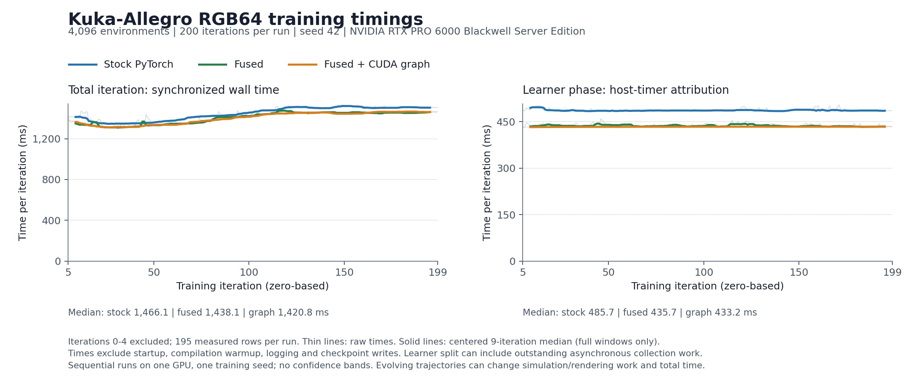
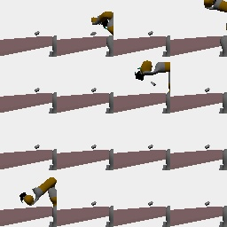

# SRAM-oriented training in Isaac Lab 3.0

Branch: `sram-resident-training`. Base: Isaac Lab `v3.0.0`, commit
`e3f7d9ff1f5d7f8280de3ece9000b7117f66bcf4`. Research checked on 2026-11-22.

The opportunity is to keep repeatedly used learner intermediates on chip and remove launch and synchronization
overhead from PPO. This branch contains a persistent Cartpole training megakernel, fused operations and separate
persistent actor/critic updates for the native Kuka-Allegro camera learner, lossless history storage, a real-environment runner and a separate
learner benchmark. The Cartpole implementation
can keep its rollout, environment state, parameters and optimizer
working state in shared memory and registers during a launch. Real Kuka RGB64 measurements below test selective
fusion with the original trainable CNN. The dense native camera rollout at 4,096 environments cannot fit entirely
in the GPU's SRAM.

For Ruben: real RGB64 Kuka training measured **11–12% higher learner throughput and 2–3% higher full-iteration
throughput** in 200-iteration runs at 4,096 environments on one RTX PRO 6000 Blackwell. The native trainable CNN,
23-action policy, critic and PPO recipe are preserved. These are single-seed throughput observations, not a
time-to-success result. The smaller two-phase persistent learner below is separate from these throughput results.

**The complete perception learner is not yet SRAM-resident.** Its dense native rollout alone contains 1.5 GiB of
images and 797.5 MiB of state/history at 4,096 environments. At 64 environments, the branch now retains the native
actor's and critic's parameters, gradients and Adam moments on chip for each network's 40 optimizer steps in
separate cooperative launches. The actor launch includes the complete trainable CNN and its backward pass.
Repeated state histories can also be compacted losslessly. Observations, activations and communication buffers
still use global memory; GAE and normalization remain outside those launches. An entirely SRAM-resident visual
learner remains unimplemented. Neither CUDA graphs nor a persistent
kernel imply zero device-memory traffic. The measurements and capacity analysis below make that remaining
engineering work concrete.

## What is implemented, and what each result would prove

| Path | Work performed | What it can establish |
| --- | --- | --- |
| `source/isaaclab_sram/isaaclab_sram/megakernel.py` and `kernels/ppo_cartpole.cu` | Persistent cooperative CUDA kernel: analytic Cartpole physics, rollout, GAE, PPO backward, gradient reduction and Adam | Whether a sufficiently small complete learning loop benefits from persistent on-chip state |
| `scripts/sram/verify_megakernel.py` | Numerical comparison with float64 closed-form physics, PyTorch autograd and RSL-RL optimizer references | Numerical agreement for the tested Cartpole configurations; not Kuka physics or visual learning |
| `scripts/sram/projection/measure_update_cost_cnn.py` | Native Kuka actor/critic learner on synthetic observations; eager versus captured CUDA graphs, precision modes, memory and operation accounting | Learner throughput and launch-overhead opportunity for the native architecture; not rendered observations or policy quality |
| `source/isaaclab_sram/isaaclab_sram/perception.py`, `spatial_softmax.py`, `ppo_kernels.py` | Native trainable CNN and critic with fused spatial softmax, PPO objective, GAE and Adam | Whether selective fusion improves the original learner while preserving its gradient computation |
| [Persistent critic](../../source/isaaclab_sram/isaaclab_sram/persistent_critic.py), [CUDA kernel](../../source/isaaclab_sram/isaaclab_sram/kernels/ppo_native_critic.cu) and [PPO integration](../../source/isaaclab_sram/isaaclab_sram/persistent_perception.py) | All 40 native critic forward/backward, clipping and Adam steps in one cooperative launch | Critic parameter, gradient and optimizer residency; not residency of the visual actor or rollout |
| [Persistent actor](../../source/isaaclab_sram/isaaclab_sram/persistent_actor.py), [CUDA kernel](../../source/isaaclab_sram/isaaclab_sram/kernels/ppo_native_actor.cu) and [full PPO integration](../../source/isaaclab_sram/isaaclab_sram/persistent_full_perception.py) | Complete native RGB64 CNN, spatial softmax, policy MLP, Gaussian PPO backward, clipping and Adam; separate 40-step actor and critic launches | Parameter, gradient and optimizer residency during each network's update; not residency of the rollout, activations or complete learning process |
| [History codec](../../source/isaaclab_sram/isaaclab_sram/compact_history.py) and [rollout adapter](../../source/isaaclab_sram/isaaclab_sram/compact_storage.py) | Store processed state frames once and reconstruct native histories exactly | Reduced retained global observation storage, including real resets; not on-chip placement |
| `scripts/sram/train_kuka_perception.py` | Real Kuka camera rollouts and native PPO with `torch`, `sram`, `sram_graph`, `sram_critic` and `sram_full` backends, checkpoint and integration checks | Actual camera/task execution and iteration throughput; longer evaluation is still needed for learning quality and time to success |

The branch includes [real camera run summaries](data/perception/README.md),
[isolated kernel measurements](data/kuka_kernel_microbenchmark.json) and the [device query](data/gpu.json). Historical
`data/locomotion_footprint.json` and `data/rl/` describe different workloads; they cannot establish Kuka RGB speed or
fit.

## What SRAM means here

Each SM has its own registers and shared memory. Shared memory is scoped to the thread block and does not preserve
values across ordinary kernel launches. Keeping a block alive can preserve its own state, subject to register and
shared-memory capacity. Compiler spills may use device memory. GPU global allocations are backed by device DRAM
even if many accesses hit L2. These are distinct residency claims. See the
[CUDA programming model](https://docs.nvidia.com/cuda/cuda-programming-guide/01-introduction/programming-model.html)
and [shared-memory lifetime](https://docs.nvidia.com/cuda/archive/13.0.1/cuda-c-programming-guide/index.html#shared).

| Claim | Evidence needed |
| --- | --- |
| Intermediate activations stay on chip within a fused region | Kernel source/layout, actual shared-memory and register usage, spill counts and memory profiling |
| Parameters and optimizer state persist on chip for a training launch | Persistent allocation/lifetime, no parameter or moment loads/stores inside the iteration loop, and no spills |
| Rollouts stay on chip | Capacity calculation and verified launch plan, including all fields, padding and scratch space |
| Global buffers are usually served from L2 | L2 hit rate and DRAM-byte counters for the measured run |
| The entire native simulator, renderer and learner use only SRAM | All of the above for every participating component; this branch does not satisfy this claim |

CUDA's persisting-cache policies preferentially retain data; they do not turn global allocations into guaranteed
SRAM storage. A buffer fitting in L2 is a capacity observation, not proof that its accesses avoid DRAM. See
[NVIDIA L2 cache control](https://docs.nvidia.com/cuda/cuda-programming-guide/04-special-topics/l2-cache-control.html).

Blackwell products have different shared-memory and occupancy limits. The planner must query the actual GPU
rather than applying one
Blackwell product's limits to all Blackwell GPUs. Shared-memory capacity, register pressure, block residency and
barrier overhead all constrain fusion. See the
[Blackwell tuning guide](https://docs.nvidia.com/cuda/blackwell-tuning-guide/index.html).

The [actual device query](data/gpu.json) on this RTX PRO 6000 Blackwell reports 188 SMs,
100 KiB shared memory per SM, 99 KiB per block, 18.36 MiB aggregate shared memory,
47 MiB aggregate register files and 128 MiB L2. The native 2.28 GiB observation rollout
exceeds even the sum of these physically separate on-chip stores. Their capacities
cannot be pooled into a single directly addressable SRAM allocation.

## The Cartpole megakernel

One cooperative launch executes the requested number of training iterations. Each block owns a fixed slice of
environments and a replica of the small actor/critic. The loop computes actions, advances an analytic two-degree-
of-freedom Cartpole, collects rewards, resets environments, computes GAE, then runs PPO minibatches and Adam.
Cross-block gradient reduction and normalization use global scratch buffers and grid synchronization.

The implementation is specialized for four observations, one action and two `[32, 32]` ELU networks. Its analytic
Cartpole follows the task's Newton/MuJoCo-Warp settings; it does not execute the general Newton solver in the kernel.
It is a useful complete-loop demonstration, but substituting this physics for Kuka's articulated contacts would
change the task.

| State | Cartpole location during a non-debug launch |
| --- | --- |
| Environment and episode state | Shared memory; loaded from and saved to global checkpoint buffers at launch boundaries |
| Rollout fields | Shared memory when the queried launch plan fits; otherwise global memory |
| Weights | Replicated shared-memory/register working copies, with global input/output buffers |
| Adam moments | Per-owner-thread working values; global input/output buffers at launch boundaries |
| Activations and local gradient scratch | Shared memory/registers; inspect compiled register/spill reports |
| Minibatch permutation | Shared-memory cache when the planner can fit it; otherwise recomputed keyed permutation |
| Gradient partials and reduced gradients | Global memory, potentially served by L2; no guaranteed L2-only placement |
| Statistics, debug output, profiling output | Global memory; debug/profiling builds change traffic |

Initialization, checkpoint export and launch boundaries also transfer data. The kernel uses fixed-order gradient
reduction, but two logging sums use floating-point atomics. Bitwise parameter determinism tests and numerical
comparisons should be reported separately from claims about stock RSL-RL equivalence: random streams and the
per-block stratified minibatch permutation differ from the stock global permutation.

A fresh 150-iteration run at 4,096 environments and seed 42 measured the following
on the same GPU. Both exported policies were evaluated in stock Newton Cartpole
on 8,192 held-out episodes with evaluation seed 10002:

| Cartpole path | Process wall time | Training loop | Held-out return, mean ± episode std (maximum ≈5) |
| --- | ---: | ---: | ---: |
| Stock Isaac Lab/RSL-RL | 30.64 s | 21.13 s | 4.9455 ± 0.0697 |
| Persistent analytic megakernel | 3.28 s | 0.0738 s | 4.9502 ± 0.0685 |

Process wall time, including imports, setup and checkpoint export, improved 9.34×.
The loop comparison uses host iteration times rounded to 0.01 s for stock and
CUDA events for the megakernel. Both exclude process imports and environment
construction, but stock includes first-iteration setup (including 0.430 s graph
capture), while megakernel compilation/initialization are outside its CUDA events.
Specialized analytic physics replaces the general engine. NVRTC's cache was warm.
Only one training seed was evaluated. This is a small
complete-loop feasibility result, **not a predicted Kuka speedup**. See the
[raw stock run](data/cartpole/stock_torch_s42.json),
[megakernel run](data/cartpole/sram_s42.json) and
[commands/source hashes](data/cartpole/manifest.json).

The compiled kernel used 223 registers per thread and 72,696 bytes dynamic plus
1,232 bytes static shared memory per block. Its driver report of 32 bytes local
memory corresponds to a 32-byte stack frame. An [audit of the matching binary](data/cartpole/resource_audit.json)
found local loads/stores only in `sincosf` large-angle reduction branches, with
none in the learner loops. That supports absence of spilled learner state, but
does not measure runtime branch execution or DRAM traffic. Global cross-block
reductions and checkpoint transfers remain.

## Native Kuka-Allegro perception workload

The target is `Isaac-Lift-KukaAllegro-Camera` with `presets=single_camera,rgb64`,
`physics=newton_mjwarp` and `renderer=newton_renderer`. The local
[agent configuration](../../source/isaaclab_tasks/isaaclab_tasks/core/lift/config/kuka_allegro/agents/rsl_rl_ppo_cfg.py)
and [camera configuration](../../source/isaaclab_tasks/isaaclab_tasks/core/lift/config/kuka_allegro/camera_cfg.py)
define:

- A 23-action policy and 32 control steps per rollout; five PPO epochs and eight minibatches, with fixed learning
  rate `7e-5`.
- A trainable RGB actor: uint8 `3 × 64 × 64` images, three ELU convolutions with channels `[16, 32, 32]`, kernels
  `[8, 4, 3]`, strides `[4, 2, 1]`, learned-temperature spatial softmax, and an MLP `[512, 256, 128]`.
- An actor with 699 MLP inputs: 170 policy/history values, 465 proprioception/history values and 64 encoded visual
  coordinates. A privileged critic consumes 1,595 state/history/point-cloud inputs and uses the same hidden widths.
- Running normalization for one-dimensional observation groups. Images remain uint8 in rollout storage and are
  converted/scaled inside the model.

This is a perception workload with additional state inputs. In particular, `policy` contains object orientation,
and the critic's point cloud comes from known object geometry and pose. It is not a pixels-only lift benchmark.
Preserving this routing matters when comparing implementations.

The following are **calculated lower bounds**, not allocator measurements. They count unique RGB images and the
three float32 observation groups once per transition, without actions, values, advantages, old log probabilities,
optimizer state, activations, simulation buffers or rendering workspaces:

| Environments | RGB64 image rollout, 32 steps | Float32 state/history rollout | Combined lower bound |
| ---: | ---: | ---: | ---: |
| 256 | 96 MiB | 49.84 MiB | 145.84 MiB |
| 1,024 | 384 MiB | 199.38 MiB | 583.38 MiB |
| 4,096 | 1,536 MiB | 797.50 MiB | 2,333.50 MiB |

Formulas: `N × 32 × 3 × 64 × 64` bytes for images and `N × 32 × 1595 × 4` bytes for state/history. Even the
256-environment input rollout exceeds a 128 MiB L2 cache. Registers and per-SM shared memory are also partitioned
resources, so adding their advertised capacities does not create one freely addressable memory pool.

For these layer shapes, an analytic parameter count is about 1.53 million including the action standard deviations
and spatial-softmax temperatures. Float32 parameters, gradients and two Adam moments require about 23.31 MiB before
any replicas, activations or workspace. The resolved model and its allocator measurements remain authoritative.

Storing only encoded features would be an algorithm change if the encoder remains trainable: PPO re-evaluates old
images under current encoder parameters in each minibatch. A frozen encoder, compressed images, smaller networks,
fewer environments or shorter rollouts are valid separate experiments, but each changes the native comparison and
must be labeled. Recomputing feature tiles during backward can trade arithmetic for activation storage while
retaining the original image inputs and trainable encoder.

## Megakernel design options

The persistent Cartpole implementation explores the strongest form of fusion: simulator plus learner, including
the entire optimizer loop. For native visual manipulation, the practical next boundary is the learner update.
The simulator and renderer produce global observation tensors; a learner can stream those inputs into tiles,
keep short-lived activations on chip, and return actions or updated parameters. This reduces traffic without
claiming that the full rollout or renderer is resident.

Three primary-source precedents help choose that boundary:

1. [NVlabs tiny-cuda-nn](https://github.com/NVlabs/tiny-cuda-nn) demonstrates fully fused small MLPs and runtime
   integration of model device functions into larger kernels. Its documentation also warns that large widths or
   models can make fusion slower and that the fully fused MLP requires substantial shared memory. It provides a
   useful small-network precedent, not a turnkey implementation of this spatial-softmax CNN and PPO update.
2. [Hazy Research's Llama megakernel](https://hazyresearch.stanford.edu/blog/2025-05-27-no-bubbles) uses persistent
   execution, shared-memory paging and explicit dependency counters to reduce launch gaps and pipeline work.
   Weights still arrive from global memory. Its
   [released implementation](https://github.com/HazyResearch/Megakernels) is an inference example; its published
   speedups cannot be transferred to robot training or CNN backward passes.
3. Recent research on
   [megakernel residency and resource costs](https://arxiv.org/abs/2611.00495) and
   [tile-level dependencies between separate kernels](https://arxiv.org/abs/2611.16248) shows why persistent execution
   should compete with optimized separate kernels. These are inference studies, but motivate a CUDA-graph and
   library-kernel baseline before committing to a large custom scheduler.

A CNN implementation must handle convolution forward and both gradients, ELU, spatial softmax and its trainable
temperatures, policy/value losses, gradient clipping, normalizer updates and Adam. Fusion that preserves all of
those operations is a stronger test than timing a small MLP over precomputed frozen image features. Large GEMMs
and convolutions should retain efficient tensor-core tiling; reducing launches at the expense of arithmetic
throughput can lose overall.

The selective-fusion perception path preserves the native convolution/GEMM libraries and trainable CNN. It fuses
spatial-softmax probabilities and coordinate expectations within each feature-map tile; backward recomputes
probabilities, including gradients for the learned temperatures. Separate fused kernels cover GAE and the PPO
objective/backward, and PyTorch's fused Adam applies optimizer updates. This is selective fusion across several
kernels, not one persistent visual training megakernel. Convolution activations, inputs/outputs, gradient partials
and persistent learner state still use global memory. The native camera recipe uses fixed learning rate and
float32 model state with TF32 library operations; unsupported mixed precision, recurrent/distributed training,
RND, symmetry, adaptive scheduling and alternate objectives fail explicitly.

### Implemented intermediate step: two persistent network updates

The experimental `sram_critic` backend supports the native 32-step, five-epoch,
eight-minibatch recipe at up to 64 environments. It keeps the full privileged
critic, `1595 → 512 → 256 → 128 → 1`, including ELU activations and biases. One
cooperative launch performs all 40 critic optimizer steps; 981,505 parameters,
their accumulated gradients and two Adam moments contain 14.98 MiB of logical
state, sharded in block-owned shared memory across 188 blocks. Per-block padding
and scratch increase the reserved allocation. Native parameters and optimizer state are imported
at entry and exported at exit. Their global arrays are not accessed inside the
optimizer loop.

The actor and critic have disjoint parameters and separate native gradient
clipping, so this fixed-rate recipe can execute their updates in separate phases
using the same minibatch permutation. The native CNN, spatial-softmax temperatures,
23-action policy remain trainable, and running normalizers still update. Complete-update tests
against the fused `SramPerceptionPPO` baseline passed after resuming nonzero Adam
moments and changing observations across two updates, comparing actor/critic
parameters, normalizer buffers, optimizer state and losses. Separate tests compare
that fused baseline against native RSL-RL PPO. These comparisons use IEEE float32; the
custom critic uses a float64 sum of squared gradients for clipping, so arithmetic
is numerically comparable rather than bitwise identical.

All 17 perception and history-compaction tests passed, including the four
[complete-update tests](data/persistent_learner/production_update_tests.txt);
the earlier 102-test Cartpole suite also passed. These tests exercise the native
shared-activation MLP container, resumed Adam state and exact history reconstruction
across resets, observation noise, delays and consecutive rollouts.

The [matching binary audit](data/persistent_critic/resource_audit.json) records
254 registers per thread, 256 threads per block, 99,200 dynamic plus 144 static
shared bytes per block (99,344 user bytes), and one resident block per SM. With
1,024 bytes reserved by the CUDA runtime, total shared usage is 100,368 bytes,
rounded to a 100,480-byte allocation. The
compiler reports zero stack/spills; disassembly contains no local load/store
instructions. The binary's 1,168-byte static shared section includes 1,024 bytes
reserved by the CUDA runtime (`RESERVED_SHARED_MEMORY_PER_BLOCK`), accounting for
the difference from the driver's 144-byte user-static allocation. The occupancy
check uses the CUDA driver. This
supports residency of the critic's shared working state for this exact binary.
It does not establish zero DRAM traffic: critic inputs, activation tiles and
cross-block communication remain global, including a 23.5 MiB adjoint mailbox
and a 3.74 MiB diagnostic gradient output. This exact binary nearly fills each SM's
register/shared budget, so the actor below runs in a separate phase. Persistent-critic performance and memory-traffic
measurements are separate from the published 4,096-environment comparison.

The `sram_full` backend additionally puts the complete native actor update in a
second persistent launch. It consumes raw uint8 RGB64 images and normalized
state, computes all three convolutions and the gradients needed to train every layer,
learned-temperature spatial softmax, the policy MLP, Gaussian log probabilities,
clipped PPO loss, entropy, actor-wide gradient clipping and Adam. All 546,206
actor parameters, their gradients and two moments form 8.33 MiB of logical
working state, held in block-owned shared memory for the actor's 40 optimizer
steps. This preserves the 23 actions and trainable encoder; it does not substitute
cached or frozen image features.

The production actor replicates CNN filters across the 188 blocks so more blocks
can share convolution work. The canonical 546,206 parameters still define the
native model and checkpoint. Another 118,372 parameter copies add 1,893,952 bytes
of weight/gradient/Adam state: 10,633,248 bytes (10.14 MiB) total logical resident
state, within a 12,793,024-byte (12.20 MiB) uniform shared allocation. Replicas
reduce their partial gradients once per minibatch and apply identical clipped
Adam updates; only canonical copies contribute to the actor-wide gradient norm
and checkpoint export.

The actor retains eight-sample tiles. Its current
[binary audit](data/actor_replication/resource_audit.json) records
254 registers per thread and 68,048 dynamic plus 208
user-static shared bytes per block. Including the runtime's 1,024-byte reserve
gives 69,280 bytes per block. Compiler reports show zero stack/spills and the
driver reports zero local bytes; disassembly has no local load/store sites.
Its global adjoint mailbox is 3,686,400 bytes (3.52 MiB). CNN replica gradients
use 555,728 bytes aliased within that mailbox once per minibatch, so keeping
gradient shards resident does not eliminate global gradient traffic. Image
inputs, convolution/MLP activation tiles, deltas, probabilities and output
statistics also remain global. Both networks load native parameters
and moments on entry and export updates on exit. The two launches do not retain
both networks' state simultaneously, and neither stores the full rollout on chip.

For the earlier actor prototype, synthetic complete-update checks at 1 and 64 environments passed against the
production `SramPerceptionPPO` baseline after loading nonzero Adam state and
performing two subsequent 40-step updates with changed observations and running
normalizers. They compare every actor/critic parameter, normalizer buffer, Adam
tensor and loss, and require exact CPU/CUDA RNG-state equality. The reference
uses native library CNN/MLP operations with the previously verified fused
objective and optimizer. Independent actor checks also compare directly against
the unmodified native actor with default and fused Adam. These are numerical
checks on synthetic rollouts, not real-task performance or learning results.
The [archived validation summary](data/persistent_learner/summary.json) links
the numerical gates and exact source/cubin hashes. The 64-environment resumed
full-update comparison's largest model or optimizer error was `6.98e-8`.

An [earlier three-iteration native RGB64 run](data/persistent_learner/full64_camera_smoke_TIMING_EXCLUDED.json)
also passed at 64 environments with compact histories, native reset initialization
and IEEE float32. Camera images varied, CNN weights changed, all parameters
remained finite, and actions depended on the images. A fresh unmodified native
actor loaded from the checkpoint matched actions within `7.45e-8`. An unrelated
GPU process was recorded at startup, so all timings from this smoke are excluded.
This establishes real-task execution, without a convergence or actor/full-learner
performance claim. The tested source was uncommitted; its recorded hashes identify
the implementation. The later wrapper-only minimum-32-CTA safety guard leaves
the eight-sample tile and CUDA kernel unchanged.

The replicated actor passed new independent default/fused-Adam checks at 64
environments and two resumed full updates with exact CPU/CUDA RNG equality. The
largest full-update model or optimizer error was `1.19e-7`; all four production
update tests passed. The [replication validation summary](data/actor_replication/summary.json)
links these checks, the raw test log and exact source/cubin hashes. A new
[three-iteration real RGB64 run](data/actor_replication/full64_camera_smoke_TIMING_EXCLUDED.json)
passed with native reset initialization, compact histories, changing CNN weights
and finite parameters. Its fresh native checkpoint actor matched actions within
`5.96e-8`, and image changes affected actions. No continuous GPU-process monitor
covered this smoke, so all its timings are excluded. These runs identify the
uncommitted tested implementation by hash and establish execution and numerical
parity, without a convergence claim.

The full backend preserves native discarded action-sampling RNG consumption with
one equivalent-shaped `torch.normal` call per optimizer minibatch. Normalizers
update after both phases; GAE, history reconstruction, normalization, permutation
generation, packing and checkpoint copyback remain separate operations using
global tensors. The persistent actor currently supports one uint8 `3 × 64 × 64`
RGB camera; depth and multiple cameras are unsupported. An entirely on-chip
visual learner therefore remains a further implementation step, despite both
networks' forward/backward and optimizer loops now being persistent.

### Screened CNN replication comparison

Five independently screened pairs compared the previous persistent actor
prototype with the replicated actor on one fixed synthetic 2,048-sample rollout,
using 256-sample minibatches, 40 optimizer steps, fused Adam and eight-sample tiles
for both implementations. Identical resumed state was restored outside each
measurement, after three warmups per implementation. The median complete actor
wrapper host times were:

| Previous persistent prototype | Replicated persistent actor | Ratio of median times |
| ---: | ---: | ---: |
| 466.65 ms | 240.48 ms | 1.9405× |

The [raw paired record](data/actor_replication/screened_pairs_t8.json) preserves
all six attempts, including one rejected for an external CUDA process. Each pair
required 500 ms of sampled quiet beforehand, alternated execution order and
sampled processes every 100 ms plus both boundaries. Sampling cannot exclude
activity between samples, and listed desktop services were excluded. Every
accepted measurement passed model and metric parity. The interval includes
packing, validation, launch, copyback and final synchronization; compilation,
warmup, checkpoint restoration, reference checks and device queries are excluded.

The raw record's historical `publication_allowed: false` flag is unchanged. The
[publication summary](data/actor_replication/summary.json) records the subsequent
review accepting only this screened comparison against the prior prototype.
This is one GPU and one synthetic rollout, without confidence intervals. It is
not a native-PyTorch or whole-camera speedup; those component and complete-task
comparisons remain pending.

### Controlled critic timing and measured traffic

Separate clean-source benchmarks at commit `df7392fb4` replayed the native critic
on the same synthetic 2,048-sample rollout: 256 samples per minibatch and 40
optimizer steps, with TF32 disabled. Each repeat restored identical nonzero Adam
state outside the timed interval. After two warmups, 20 repeats measured:

| Native critic optimizer | Eager PyTorch median | Persistent median | Speedup |
| --- | ---: | ---: | ---: |
| [Default Adam](data/persistent_learner/critic64_default_benchmark.json) | 92.32 ms | 34.48 ms | 2.68× |
| [Fused Adam](data/persistent_learner/critic64_fused_benchmark.json) | 86.98 ms | 34.56 ms | 2.52× |

These CUDA-event intervals include wrapper packing/copyback and can include host
launch gaps. Compilation, warmup and checkpoint restoration are excluded. Model,
Adam-state and loss parity passed. The eager reference has no CUDA-graph control;
these are critic-only measurements, excluding the actor/CNN, GAE, simulation and
rendering. They do not predict full visual-learner or iteration speedup.

A [warm-cache Nsight Compute capture](data/persistent_learner/critic_warm_ncu_raw.csv)
of the entire 40-step critic kernel measured **31,195,136 DRAM read bytes and
5,376,768 DRAM write bytes**, with a 99.940035% L2-sector hit rate. The capture
used three kernel-replay passes, `--cache-control none` and `--clock-control none`.
It includes kernel entry imports and exit exports, but excludes outer wrapper
packing/copyback; counters cannot separate boundary traffic from internal global
mailboxes. Warm cache state and clocks were uncontrolled, and the profiler
warned about possible inconsistency. This is observed nonzero DRAM traffic,
not guaranteed cache residency. Instrumented timings are excluded, and a paired
quiet warm/cold comparison is not available. The
[provenance manifest](data/persistent_learner/validation.json) records that these
critic benchmarks and the warm capture finished before identified external GPU
contention; the overlapping cold capture and camera timings are excluded.

### Lossless history storage and the remaining residency boundary

With `--compact_history`, each processed state frame is retained once, together
with the initial history prefix and reset boundaries. The adapter discovers the
live observation manager's term order and reconstructs exact native minibatches;
unsupported history evolution raises an error. Raw camera pixels are unchanged,
and normalizer updates reconstruct full state groups to preserve reduction order.
An actual three-iteration RGB64 run at 64 environments, with native reset
initialization and the `sram` backend, recorded these retained allocations:

| Allocation | Bytes | MiB |
| --- | ---: | ---: |
| Dense native observations before compaction | 38,232,064 | 36.46 |
| Unchanged RGB image rollout | 25,165,824 | 24.00 |
| Processed state frames and history prefixes | 2,939,904 | 2.80 |
| Compact state storage including reset metadata | 2,966,528 | 2.83 |
| All retained observations after compaction | 28,132,352 | 26.83 |
| All rollout fields after compaction | 28,740,608 | 27.41 |

The [compact-run summary](data/persistent_critic/compact_rgb64_native64_summary.json)
records real camera observations, changed CNN weights, finite parameters,
image-sensitive actions and a checkpoint matching an unmodified native actor.
The frame and total-state rows overlap; they are not additive. Compaction saves
26.4% of retained observation bytes in this run, but every listed allocation is
global, and gathering/normalization create dense temporary state tensors. This
is execution and storage evidence, not a convergence or performance result. The
[package README](../../source/isaaclab_sram/README.md#kuka-allegro-perception-training)
describes both options and their limits.

For a subsequent entirely on-chip visual learner, 64 environments are a
plausible capacity experiment. Losslessly reconstructing repeated state histories
reduces estimated rollout plus float32 parameters, gradients and Adam moments to
50.70 MiB, before scratch, padding and normalizers. At 128 environments this grows
to 78.08 MiB, already above aggregate registers/shared memory. These are design
calculations, not proof of complete learner residency: each SM
has its own address space and cross-SM state exchange still needs a mechanism.

That experiment would retain the native CNN, actor/critic, 23 actions and all 40
PPO optimizer steps, reconstruct histories and recompute activation tiles inside
a persistent cooperative learner. The simulator would supply observations at an
explicit boundary. Start with cache-backed state and measure DRAM traffic before
asserting SRAM residency. Warp-NN has convolution backward support but materializes
global layer arrays; tiny-cuda-nn does not directly implement this architecture.
Neither provides a ready-made complete visual PPO megakernel. The branch's
working perception implementations now include selective fusion and separate
persistent actor/critic phases. The next step must retain rollout inputs and
activation/reduction scratch alongside the network state, incorporate compact
history reconstruction, and verify lifetimes across the complete learner update.
Activation recomputation and different state layouts can change the capacity
tradeoff; aggregate capacity alone does not prove that a layout will fit or run
without spills.

## How fast could it be?

On one RTX PRO 6000 Blackwell Server Edition (188 SMs, driver 580.178.04, CUDA 13.0,
PyTorch 2.11.0, RSL-RL 5.5.1), the longer real RGB64 comparison measured:

| Native Kuka RGB64, 4,096 environments | Iteration median (p10–p90) | Learner median | Transitions/s |
| --- | ---: | ---: | ---: |
| Stock RSL-RL | 1.466 s (1.351–1.513) | 486 ms | 89,405 |
| Fused operations | 1.438 s (1.329–1.462) | 436 ms | 91,140 |
| Fused operations + CUDA graph | 1.421 s (1.319–1.463) | 433 ms | 92,254 |

Each run uses seed 42, native reset initialization, **200 iterations**, and five
warmup iterations. Each performs 26,214,400 transitions and 8,000 optimizer
minibatches. Runs were sequential in the order graph, stock, fused, on clean
implementation commit `c117928647ddad83c480c7a267c8f4225ab9ff6e`, with identical
source hashes. Total iteration timing synchronizes CUDA and includes physics,
rendering, collection and learning. The phase split uses host timer attribution;
startup/compilation, logging and checkpoint writes are outside steady-state
timings. Raw rows, early/late windows and GPU samples are in the
[comparison record](data/perception/comparison_4096_200.json) and
[run summaries](data/perception/README.md).

Learner throughput improved **1.115× with fusion** and **1.121× with fusion plus
graphs**. Observed iteration throughput improved **1.019× and 1.032×**. Simulation
work changes as trajectories and reset frequency evolve, so these full-iteration
ratios are single-seed observations, not isolated causal gains or confidence
intervals. The graph backend also changes the random stream by omitting unused
optimization-time samples. Multiple training seeds and held-out evaluation remain
necessary for a time-to-success claim.



The initial 30-iteration comparison suggested 1.17× overall and 1.30× learner
throughput, but its stock learner median was 563 ms rather than the longer run's
486 ms. Those [short-run records](data/perception/README.md) are retained for
transparency; the longer comparison is the headline result. Graph replay adds
little at this batch size. At 64 environments it reduced the fused learner from
about 146 ms to 28 ms in a three-iteration execution smoke test, a separate
launch-overhead result with only two measured iterations.

All three native-scale runs produced real RGB observations, changed CNN weights,
kept parameters finite and loaded checkpoints into an unmodified native actor.
Maximum action disagreement in IEEE float32 was below `5.4e-7`; TF32 comparisons
are separately recorded because library matmul and fused reductions round
differently. RGB and depth graph smoke runs also passed. Peak PyTorch allocations
were 8.71 GiB for stock/fused and 9.03 GiB for the graph path, excluding allocations
made by simulation/rendering outside PyTorch. Global-memory use remains substantial.
No run solved the lift task. Maximum logged training success was 0%, 0.0049% and
0.0102% respectively; these are training metrics, not held-out success estimates.



Isolated hot paths show where fusion helps. These are 100-repeat CUDA-event
medians with **both implementations captured in CUDA graphs**, excluding capture
and compilation. They use native minibatch/rollout shapes and do not include CNN
convolutions, gathering, optimizer updates, simulation or rendering:

| Operation | Native | Fused | Speedup |
| --- | ---: | ---: | ---: |
| PPO objective forward/backward, 16,384 × 23 actions | 0.144 ms | 0.0226 ms | 6.37× |
| Spatial softmax forward/backward, 16,384 × 32 × 4 × 4 | 0.373 ms | 0.0501 ms | 7.44× |
| GAE and global normalization, 32 × 4,096 | 0.462 ms | 0.0140 ms | 33.15× |

The [raw microbenchmark](data/kuka_kernel_microbenchmark.json) also includes eager
controls, wall times and compiled resources. Its eight Triton kernels report zero
spill slots, 12–76 registers per thread and 0–128 bytes shared memory per block.
This supports the residency of their local intermediates; global inputs, outputs
and partial reductions remain. DRAM-byte profiling has not been performed for
these isolated Triton kernels.

Separate three quantities when interpreting these results:

- **Controlled learner speedup:** replay identical collected transitions with the same network, PPO settings and
  precision, eager versus optimized. The real-environment phase timings above use separate trajectories.
- **Iteration speedup:** collection plus learning, including physics, cameras, reset and observation handling.
- **Time to success:** evaluation against the same lift criterion across several seeds, including startup and
  compilation where those costs matter to the use case.

For a measured learner fraction `f` and learner-only speedup `s`, the iteration speedup is
`1 / ((1 - f) + f / s)` when collection time is unchanged. Here learning accounts
for approximately one third of stock iteration time: a 1.12× learner predicts
roughly 1.04× overall, and a zero-time learner would cap the gain near 1.5× if
collection were unchanged. These are arithmetic bounds under that assumption,
not measured implementations. If fused inference also improves collection,
measure that term separately.

The CNN benchmark already supports synchronized host timing, CUDA-event spans, profiler kernel counts,
activation/storage accounting and optional comparison with recorded labperf collection times. Its synthetic
images permit controlled learner experiments, but do not exercise camera rendering, manipulation contacts,
observation history evolution or convergence. Mixed-precision results must be separated from the FP32/TF32
baseline; they combine a precision change with scheduling changes.

## Reproduce and validate

Validation on this GPU covers 102 Cartpole tests and 17 tests of perception kernels,
compact-history reconstruction and complete native PPO updates. The update tests
compare all model parameters, normalizer buffers, Adam state and losses. Graph
and persistent actor/critic tests resume nonzero optimizer state and change observations
across updates to detect stale state. The full persistent update also preserves
CPU/CUDA RNG state. The compact-history tests compare against
the actual observation manager and native rollout minibatch generator, including
noise, delays and resets. Multi-GPU execution was not tested.
Repository formatting/lint checks and a clean Sphinx HTML build with warnings
treated as errors also passed. This GitHub-native report is excluded from Sphinx;
its links and generated timing figure were checked separately.

The Cartpole verifier uses float64 autograd for its first-minibatch gradient
oracle: at 65,536 environments the CPU float32 reduction erred by `2.38e-6`, while
the CUDA result was within `1.39e-8` of float64. The existing acceptance tolerance
was retained. A deliberate one-step-late timeout mutation passed the former
state-derived check and is rejected by the independent episode-counter check.

Run from the repository root in the uv-managed environment. The experimental package is an editable dependency
in the root project and lockfile. Use the package's
[README](../../source/isaaclab_sram/README.md) for its API and supported Cartpole settings.

```bash
# Numerical verification of the persistent Cartpole loop.
uv run python scripts/sram/verify_megakernel.py --num_envs 4096 --out /tmp/cartpole-parity.json

# Persistent training plus export and evaluation in the stock Newton Cartpole environment.
uv run python scripts/sram/train_sram.py --num_envs 4096 --max_iterations 150 --eval

# Native Kuka learner architecture on synthetic RGB and state observations.
OMP_NUM_THREADS=1 uv run python scripts/sram/projection/measure_update_cost_cnn.py \
    --tasks dex_rgb64 dex_state --modes tf32 bf16 --repeats 20 --out /tmp/kuka-learner.json

# Paired real-environment runs, preserving the native camera task and reset settings.
OMP_NUM_THREADS=1 uv run python scripts/sram/train_kuka_perception.py \
    --backend torch --camera rgb64 --num_envs 4096 --iterations 200 --warmup_iterations 5 \
    --seed 42 --output logs/sram/kuka_rgb64_torch
OMP_NUM_THREADS=1 uv run python scripts/sram/train_kuka_perception.py \
    --backend sram --camera rgb64 --num_envs 4096 --iterations 200 --warmup_iterations 5 \
    --seed 42 --output logs/sram/kuka_rgb64_sram
OMP_NUM_THREADS=1 uv run python scripts/sram/train_kuka_perception.py \
    --backend sram_graph --camera rgb64 --num_envs 4096 --iterations 200 --warmup_iterations 5 \
    --seed 42 --output logs/sram/kuka_rgb64_sram_graph

# Smaller persistent-critic experiment with lossless history storage.
OMP_NUM_THREADS=1 uv run python scripts/sram/train_kuka_perception.py \
    --backend sram_critic --camera rgb64 --num_envs 64 --iterations 30 --warmup_iterations 5 \
    --compact_history --ieee_fp32 --seed 42 --output logs/sram/kuka_rgb64_persistent_critic

# Complete actor/CNN and critic optimizer loops in separate persistent launches.
OMP_NUM_THREADS=1 uv run python scripts/sram/train_kuka_perception.py \
    --backend sram_full --camera rgb64 --num_envs 64 --iterations 100 --warmup_iterations 5 \
    --compact_history --ieee_fp32 --seed 42 --output logs/sram/kuka_rgb64_persistent_full
```

Use `--camera depth64` for the corresponding depth preset with the backends other than `sram_full`.
A small execution smoke test can use `--num_envs 64
--iterations 3 --warmup_iterations 1 --smoke_reset_bank 16`; the explicit reset-bank override changes initialization
coverage and is recorded in the summary. Do not quote it as native-task learning evidence. Full comparisons omit
that override and hold the task, seed, reset distribution, network, precision and PPO settings fixed.

Each real-environment run writes an RSL-RL checkpoint, `params/`, `run.json`, TensorBoard events and
`perception_summary.json`. The summary records observation shapes/dtypes, rendered-image statistics, whether CNN
weights changed, finite parameters, checkpoint action replay, image sensitivity and per-iteration timings. The
`torch` backend is the reference learner; `sram` selects the fused learner operations;
`sram_graph` captures each minibatch update; `sram_critic` retains only the critic's
parameter/gradient/Adam working state across its optimizer steps; `sram_full`
does the same for the entire actor/CNN in a separate launch. Use `--ieee_fp32`
on every compared backend when testing the persistent updates. All retain global
state. `--checkpoint PATH` resumes native model/optimizer state; simulator,
curriculum and reset initialization start anew. The graph path
omits unused optimization-time action samples, changing subsequent rollout RNG
streams without changing the objective. Use `--iterations 30` to reproduce the
initial short comparison above.

Before publishing a numerical claim, archive the GPU model and count, driver/CUDA/PyTorch/RSL-RL versions, base
commit, branch commit, command, seed, observation shapes/dtypes, model dimensions, renderer/physics selectors,
precision, rollout size, optimizer settings, warmup, repeats and timing boundaries. Run on an otherwise idle GPU
and report median and spread. Compare equivalent successful updates, not compilation or a skipped backward pass.

For a perception implementation, require a real rendered-observation rollout, finite forward/backward values,
nonzero visual-encoder parameter updates, input-sensitive actions and a reloadable checkpoint. Then compare
learning curves and held-out lift success to the native recipe. A short smoke run proves execution, not task
mastery. SRAM claims additionally require compiled shared-memory/register/spill inspection and profiler evidence
for global-memory traffic. These remain separate acceptance gates so a passing synthetic benchmark cannot stand
in for successful visual manipulation training.
