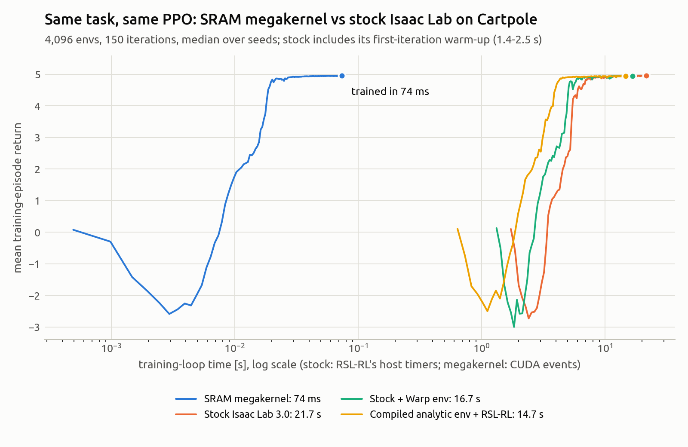
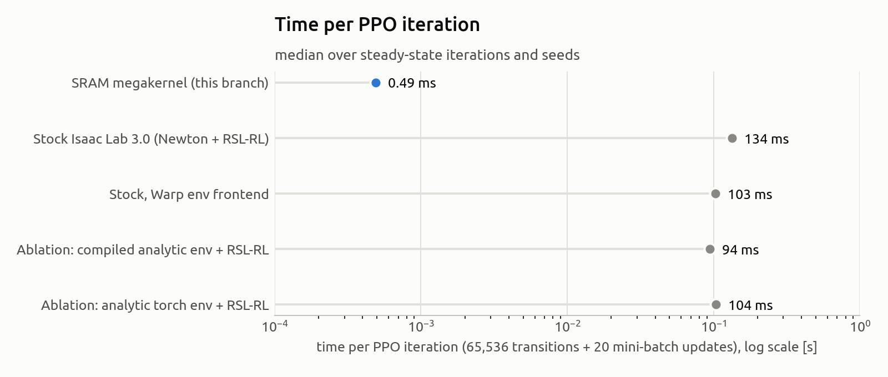
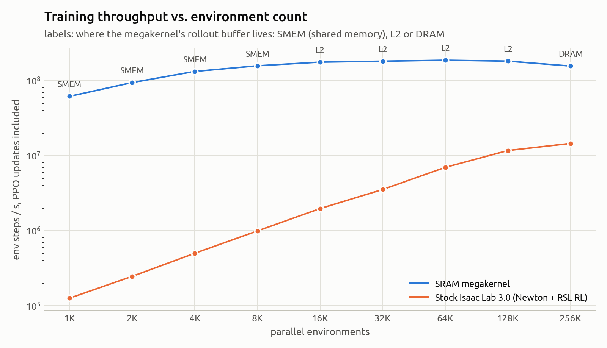
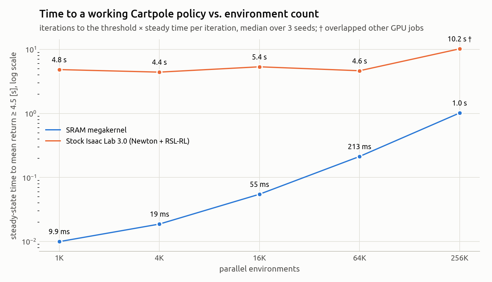

# SRAM-resident RL training in Isaac Lab 3.0

**Branch `sram-megakernel`, a fork of Isaac Lab v3.0.0.** All measurements were taken on one NVIDIA RTX PRO 6000
Blackwell Server Edition (188 SMs, sm_120, 128 MiB L2) with Isaac Lab 3.0, Newton (MuJoCo-Warp) physics and
RSL-RL 5.5.1. Anything labelled a projection is a model, not a measurement. One script reproduces the Cartpole,
scaling, time-to-policy, stock-timing and update-cost measurements ([Reproduce](#reproduce)); the footprints, hardware
micro-benchmarks and DexSuite phase breakdowns come from separate measurements, described where they are used.

"SRAM-resident" means on-chip here: the working set lives in registers, shared memory and L2, which are all SRAM,
not in DRAM. It takes three forms in this report:
- **Cartpole (measured):** everything in registers and shared memory up to 11,092 envs (the headline runs use
  4,096); the gradient exchange goes through L2, and larger runs keep the rollout buffer in global memory.
- **Locomotion (projected):** L2-resident. The lean working set at 4,096 envs is 43-174 MiB in fp32, too large for
  the 18 MiB of shared memory; the flat tasks and ANYmal-C rough fit the 128 MiB L2, G1 rough only with a bf16
  rollout.
- **DexSuite cameras (projected):** state and learners on-chip; the pixel rollout streams from DRAM.

<picture>
  <source media="(prefers-color-scheme: dark)" srcset="figures/learning_curves_dark.png">
  
</picture>

## TL;DR

- **Built (measured; Cartpole only).**
  - Isaac Lab's whole Cartpole PPO training loop runs as **one persistent CUDA kernel** with its working set
    on-chip: physics, rewards and resets, policy and value inference, GAE, 20 mini-batch updates with gradient
    clipping, the adaptive learning rate, and Adam.
  - It reads Isaac Lab's configs and writes standard RSL-RL checkpoints.
  - Each optimizer step matches RSL-RL and `torch.optim.Adam` to fp32 rounding, and the physics matches recorded
    Newton transitions.
  - Its policies score 4.951 in the stock environment (stock-trained: 4.950; the maximum is 5.0).
  - It needs ~7% more iterations to reach a return of 4.5: a median of 38 against 36
    over 15 seed-matched runs.
- **Speed (measured, 4,096 envs).**
  - Per PPO iteration: **0.49 ms against 134 ms (270×**; 220× host-timed).
  - Per training process: 3.3 s against 31 s (9.4×), which is bound by start-up.
  - Steady-state time to a return of 4.5: 19 ms of GPU time against 4.4 s (240×; 190× host-timed).
- **Against the best stock tooling (estimate, not run end to end): ~45×.**
  - The compiled closed-form env, with the policy and the PPO update in CUDA graphs, would take ≈22 ms per
    iteration.
  - With Newton kept, it would take ≈31 ms (~63×).
- **Why (measured): fusion.**
  - Even graph-captured, the update still runs 4,567 dependent kernels at ~1.6 µs each (7.3 ms); the
    megakernel runs none.
  - Moving its rollout buffer from shared memory to L2 changes its speed by under 1%, so shared memory as such is
    not the cause.
  - On-chip versus DRAM residency was not tested at this size.
- **Beyond Cartpole (projection; nothing built).**
  - Locomotion (G1, ANYmal):
    - ~1.1× from moving only the learner on-chip, about what CUDA graphs already give;
    - ~3-26× (66× optimistic), but only if a per-world physics solver, which does not exist yet, reaches 2-5% of FP32 peak with
      Isaac Lab's env code fused.
  - Cameras (DexSuite):
    - The stock recipe converged on 0 of 3 seeds in 14-15 h each, in an earlier, unpublished study.
    - Teacher-student distillation is in RSL-RL but has not been tried here. It is projected to give a camera
      policy after ~6-50 min of student training, if the student needs 0.25-2× the teacher's samples (not
      measured).
    - Kernels would add 1.5-4× on top. Newton's current ray tracer caps the gain at ~6.5× per transition.
- **The ask ([Proposal](#proposal)).**
  - Step 0: upstream CUDA-graph capture of RSL-RL's act and update (1-2 weeks).
  - P0: the distillation learning gate (1-3 days of setup, ~4 GPU-hours).
  - Step 1: a 4-6-week per-world physics slice with a go/no-go.
  - Step 2, the full fused pipeline: only if step 1 passes.

## Contents

1. [Proposal](#proposal)
2. [Results: Cartpole end to end](#results-cartpole-end-to-end)
3. [Where the time goes](#where-the-time-goes)
4. [Scaling with the number of environments](#scaling-with-the-number-of-environments)
5. [Is it the same training?](#is-it-the-same-training)
6. [How it works](#how-it-works)
7. [Beyond Cartpole: G1 and ANYmal](#beyond-cartpole-g1-and-anymal)
8. [Perceptive workloads: a DexSuite setup](#perceptive-workloads-a-dexsuite-setup)
9. [Limits](#limits)
10. [Reproduce](#reproduce)
11. Appendices:
    - [A. Speculative: SRAM-first hardware](#appendix-a-speculative-sram-first-hardware)
    - [B. Relation to the `sram-resident-training` branch](#appendix-b-relation-to-the-sram-resident-training-branch)

## Proposal

Every step has a measurable gate and is worth something on its own. Effort is an estimate for one experienced
CUDA/RL engineer unless stated otherwise.

| # | Step | Effort | Gate (go / no-go) | Value if it is the last step |
|---|---|---|---|---|
| 0 | **Upstream CUDA-graph capture of RSL-RL's act and update.** A prototype exists: `scripts/sram/projection/measure_update_cost.py`, which checks parity with RSL-RL. | 1-2 weeks | Parameters within the prototype's tolerance of stock RSL-RL; update ≥ 3.5× faster on each of Cartpole, ANYmal-C and G1 (prototype: 9.5×, 4.6×, 3.98×) | The update is 3.98-9.5× faster (measured). End to end, ~2× for Cartpole and ~1.1-1.2× for ANYmal-C and G1 (composed from measured parts) |
| P0 | **DexSuite learning gate.** Stock `DistillationRunner`: a state teacher labels a stock camera student ([details](DEXSUITE_SETUP.md#what-has-to-be-built)). | 1-3 days of setup and ~4 GPU-hours | Student held-out success ≥ 0.8 on two consecutive evaluations within 340 M transitions | A camera policy on stock code after ~6-50 min of student training (projected), where stock PPO has none |
| 1 | **Per-world physics slice for ANYmal-C and G1.** Forward kinematics, composite rigid body, sparse LDL and one solver iteration on recorded contact sets, in a persistent kernel with per-world state on-chip. | 4-6 weeks, plus review by the Newton/MuJoCo-Warp team | Physics time on recorded ANYmal-C and G1 contact sets at or below the locomotion model's expected case: 5% of FP32 peak with 2× FLOP padding, i.e. ~16 ms of physics per 4,096-env ANYmal-C iteration and ~34 ms for G1. Measure MuJoCo-Warp's own kernel time on the same sets first; the 2.5× figure in the DexSuite design has not been derived for locomotion | Decides whether the locomotion projection is reachable |
| 2 | **Persistent per-world MuJoCo-Warp with Isaac Lab's env code fused**, plus an on-chip PPO learner for any RSL-RL MLP: tensor cores, L2-resident weights, this prototype's deterministic all-reduce and Adam. | Months; needs the Newton/MuJoCo-Warp team | Go if the measured iteration beats the conservative projection on both tasks: ≤ 87 ms for ANYmal-C and ≤ 180 ms for G1 (stock: 649 and 513 ms) | The projected ~3-26× for locomotion |
| 3 | **DexSuite kernel tiers**, if P0 passes: a fused student step (K1), the device-side MDP in one CUDA graph (with K1: the graph tier G), on-chip physics (F). | K1 3-6 weeks; G 1-2 months; F 3-6 months | K1: go at ≤ 0.6 ms per 4,096-image step, kill above ~0.93 ms (cuDNN today: 1.97 ms). G: manager parity under recorded actions and a 680-820 ms student iteration. F: ≤ 0.098 µs per world-substep (MuJoCo-Warp: 0.245 µs) | Against distillation on stock code: K1 alone ≈ 1.1×, the device-side MDP alone ≈ 1.35×, G ≈ 1.5×, F 2.9-3.8× (projected) |
| 4 | **RT-core renderer prototype.** OptiX, writing uint8 frames into L2. | ~2 weeks to a first rays/s measurement (an estimate) | Go if ≥ 2× the current tracer's 2.2-2.5 G primary rays/s (≥ 5 G) for 4,096 × 64×64 frames at matching image quality; that would lift the per-transition ceiling from ~6.5× to ~13× | The only way past the ~6.5× per-transition ceiling for cameras |

The on-chip learner of step 2 is worth building only as part of the fused pipeline: on its own it adds ~2% over step
0's CUDA graphs. The Newton/MuJoCo-Warp team has not yet been asked about committing to step 2.

## Results: Cartpole end to end

Five configurations train `Isaac-Cartpole-Direct` with Isaac Lab's RSL-RL PPO settings: 4,096 envs, 16 steps per
env per iteration, 5 epochs × 4 mini-batches, 150 iterations.
- Each configuration runs for 3 seeds, each as its own process, one at a time.
- No other GPU process was seen during the kept 4,096-env runs (see [measurement hygiene](#reproduce)).
  - Runs repeated after the first pass polled for other GPU processes every 2 s.
  - The 8 kept first-pass runs were checked against the 5-s `contention.log`, whose samples missed two of the
    three ~3-s SRAM processes entirely.
  - For those, the evidence is that the three seeds' kernel times agree: 0.4921-0.4924 ms (0.06%).
- Every trained policy is then evaluated the same way in the **stock** Isaac Lab Newton environment: 4,096 envs ×
  2 episodes each, deterministic actions, the same evaluation seed.

| Configuration | Time per PPO iteration | Collection | Learning | 150 iterations (training loop) | Process wall time | Iterations to return ≥ 4.5 | Eval return in the stock env |
|---|---|---|---|---|---|---|---|
| Stock Isaac Lab 3.0: Newton MuJoCo-Warp, torch env, RSL-RL | 134 ms | 62 ms | 71 ms | 21.7 s | 31.0 s | 42/30/33 | 4.950 (4.946-4.958) |
| Stock, experimental Warp env frontend (`--frontend warp`) | 103 ms | 31 ms | 72 ms | 16.7 s | 26.1 s | 43/31/38 | 4.944 (4.933-4.953) |
| Ablation: same MDP as a batched torch env, stock RSL-RL | 104 ms | 33 ms | 71 ms | 16.3 s | 20.0 s | 42/33/37 | 4.947 (4.942-4.952) |
| Ablation: that env fused by `torch.compile` + CUDA graph, stock RSL-RL | 94 ms | 22 ms | 72 ms | 14.7 s | 20.9 s | 39/32/36 | 4.941 (4.934-4.953) |
| **SRAM megakernel (this branch)** | 0.49 ms | - | - | 74 ms | 3.3 s | 44/31/38 | 4.951 (4.947-4.953) |

- **Per PPO iteration** the megakernel is **270×** faster by CUDA-event time, or 220× if it is timed by
  the host around its 150-iteration launch, which adds launch and readback.
- **Over the 150-iteration training loop** it is 290× faster as timed. But stock's total includes its
  1.6-2.5 s first iteration, while the megakernel's excludes its 0.18 s of kernel load and initialization.
  With both warm-ups excluded it is ~270×; with both included, ~85×.
- **In process wall time** it is 9.4× faster. Start-up dominates the megakernel's process (about 3.2 of its
  3.3 s); stock's 31 s are its 22 s training loop plus ~9 s of start-up and shutdown.

How to read it:
- **Time per PPO iteration.**
  - Stock and ablations: median over iterations 4-150, from RSL-RL's own collection and learning timers
    (1 ms resolution), then median over seeds.
  - SRAM: CUDA-event time of the training launch divided by 150.
  - One iteration is 65,536 transitions plus 20 mini-batch updates.
- **Collection and Learning** are separate medians, so they need not add up to the iteration median.
- **150 iterations (training loop).** The sum of all 150 iteration times, warm-up included.
  - Stock's first iteration takes 1.4-2.5 s (median 1.7 s at 4,096 envs). That includes a CUDA-graph capture of
    0.4-0.7 s up to 65,536 envs and 1.3 s at 262,144.
  - The megakernel's ~0.2 s kernel load and initialization happen before its timed launch.
- **Process wall time.** Process start to process exit, after the checkpoint is written.
  - Stock spends ~9 s of it outside the training loop: start-up, scene building and shutdown.
  - The SRAM process spends 2.3 s importing Python packages and reading the configs, 0.2 s loading the cached kernel
    (an NVRTC cache hit takes 2 ms) and initializing, 0.09 s training and 0.1 s exporting the checkpoint. The
    remaining ~0.7 s is interpreter start-up and exit.
- **Iterations to return ≥ 4.5** is per seed.
  - The maximum possible return is 5.0: 300 steps × the alive reward of 1 × `step_dt`.
  - The threshold is applied to each trainer's own logged mean return. For stock and the ablations, that is RSL-RL's
    "Mean reward", the mean of the last 100 completed episodes. For the megakernel, it is the mean over all episodes
    completed in the iteration.
  - The kernel needs about as many iterations as RSL-RL: a median of 38 against 36 over
    15 seed-matched runs (this table and the [time-to-policy runs](#scaling-with-the-number-of-environments)).
  - It was slower in 12 of the 15 runs, ~7% on average. Per-SM stratified mini-batches or fp32
    instead of TF32 arithmetic may explain this; neither has been isolated.
- **Eval return.** In the stock Newton environment, every configuration's mean eval return is within 1.2% of the
  5.0 maximum, and every policy within 1.4%. That shows the kernel's physics transfers, but Cartpole saturates, so equivalence rests on the
  [step-by-step verification](#is-it-the-same-training).

## Where the time goes

<picture>
  <source media="(prefers-color-scheme: dark)" srcset="figures/iteration_time_dark.png">
  
</picture>

Each row replaces one part of the stack. The analytic env replaces both Newton and Isaac Lab's env layer:

| Configuration | What changes | Collection (16 steps) | Learning (GAE + 20 mini-batches) | Iteration |
|---|---|---|---|---|
| Stock Isaac Lab 3.0 | Newton MuJoCo-Warp physics, torch env, RSL-RL | 62 ms | 71 ms | 134 ms |
| Warp env frontend | the env code in Warp instead of torch (`--frontend warp`) | 31 ms | 72 ms | 103 ms |
| Analytic env | Newton replaced by the closed-form physics in a batched torch env, same MDP | 33 ms | 71 ms | 104 ms |
| Compiled analytic env | that env step fused by `torch.compile` into a CUDA graph | 22 ms | 72 ms | 94 ms |
| + update in CUDA graphs | RSL-RL's GAE and update captured in two CUDA graphs (measured on its own) | - | 7.3 ms | - |
| **SRAM megakernel** | everything in one persistent kernel, working set on-chip | ~0.04 ms | ~0.45 ms | **0.49 ms** |

What the ladder shows:
- **Isaac Lab's torch env layer, not Newton, costs ~30 ms of collection.**
  - The Warp frontend keeps Newton and gets 31 ms.
  - The analytic torch env, with neither Newton nor Isaac Lab's env layer, gets 33 ms.
  - Fusing the analytic env step into a CUDA graph saves another ~10 ms.
- **The learner is launch-bound.**
  - The eager update takes ~71 ms for 4.5 GFLOP: 0.06 TFLOP/s on a GPU with ~110 TFLOP/s of FP32.
  - It stays at 70-75 ms from 1,024 to 65,536 envs in the 150-iteration runs, while its work grows 64×.
- **CUDA graphs remove the host, not the kernel boundaries.**
  - `scripts/sram/projection/measure_update_cost.py` captures the same GAE and update math in two CUDA graphs. It
    uses a fused, capturable Adam and a device-side learning rate, and checks the parameters against RSL-RL.
  - That brings the update to 7.3 ms: 4,567 dependent kernels at ~1.6 µs of GPU time each, about the fixed cost of
    a kernel in a graph. The eager update launches 4,320; the graph runs more because of its capturable Adam and
    device-side learning rate.
- **The best software-only pipeline would still be ~45× slower than the megakernel (estimate).**
  - Combine the fastest measured parts:
    - the compiled analytic env: 22 ms of collection, of which 8.4 ms is the eager policy;
    - the policy captured in a CUDA graph: 1.0 ms per iteration;
    - the graph-captured update: 7.3 ms.
  - Together they give ≈22 ms per iteration, or ≈31 ms with Newton kept (Warp frontend).
  - This combination was not run end to end.
- **The megakernel removes the kernel boundaries.**
  - Between SMs, only three things move: one ~10 KB gradient vector per mini-batch, two doubles per iteration for
    the advantage normalization, and the logged statistics.
  - Its 0.49 ms iteration splits as follows (profile build, in-kernel `clock64` marks):

  | Phase (one iteration, 4,096 envs) | Time | Share |
  |---|---|---|
  | rollout: 16 control steps (policy + value MLPs, sampling, 2 physics substeps, reward, reset) | 39 µs | 8% |
  | bootstrap value of the last observation | 2 µs | 0% |
  | GAE + global advantage normalization (1 all-reduce) | 9 µs | 2% |
  | mini-batch permutation | 2 µs | 0% |
  | update: forward + backward on this SM's samples (20 mini-batches) | 308 µs | 62% |
  | update: deterministic gradient all-reduce across SMs (20×, 2 grid barriers each) | 89 µs | 18% |
  | update: KL-adaptive LR, gradient clipping, Adam (20×) | 49 µs | 10% |
  | **Sum** (profile build; the normal build takes 492 µs by CUDA events) | **498 µs** | |

  - The update dominates, and within it the per-mini-batch forward/backward on each SM's ~88 samples.
  - The 20 grid-wide gradient all-reduces cost 89 µs in total, ~4.5 µs each, including two grid
    barriers.
- **Where the rollout buffer lives barely matters at this size (measured).**
  - Force the rollout buffer (3-6 MiB) into global memory, where it is expected to stay in L2 (DRAM traffic was
    not measured), instead of shared memory.
  - The iteration changes by under 1%: 0.493 against 0.497 ms (+0.6%) at 4,096 envs and 0.830 against 0.837 ms (+0.9%) at 8,192 (shared memory against
    global; median of two repeats, which agree within 0.03%).
  - The speedup comes from running the whole loop as one persistent kernel, not from shared memory as such. Both
    placements are on-chip, so this does not test DRAM residency.

## Scaling with the number of environments

<picture>
  <source media="(prefers-color-scheme: dark)" srcset="figures/scaling_dark.png">
  
</picture>

| Envs | SRAM rollout buffer | SRAM: time per iteration | SRAM: steps/s | Stock: time per iteration | Stock: steps/s | SRAM / stock |
|---|---|---|---|---|---|---|
| 1,024 | shared memory (0.75 MiB) | 0.27 ms | 62 M | 130 ms | 0.13 M | 490× |
| 2,048 | shared memory (1.5 MiB) | 0.35 ms | 94 M | 133 ms | 0.25 M | 380× |
| 4,096 | shared memory (3 MiB) | 0.49 ms | 133 M | 131 ms | 0.50 M | 270× |
| 8,192 | shared memory (6 MiB) | 0.83 ms | 158 M | 132 ms | 0.99 M | 160× |
| 16,384 | global, fits L2 (12 MiB) | 1.48 ms | 177 M | 133 ms | 1.97 M | 90× |
| 32,768 | global, fits L2 (24 MiB) | 2.88 ms | 182 M | 148 ms | 3.54 M | 51× |
| 65,536 | global, fits L2 (48 MiB) | 5.60 ms | 187 M | 150 ms | 6.99 M | 27× |
| 131,072 | global, fits L2 (96 MiB) | 11.51 ms | 182 M | 179 ms | 11.72 M | 16× |
| 262,144 | global, exceeds L2 (192 MiB) | 26.78 ms | 157 M | 288 ms | 14.56 M | 11× |

SRAM: 20 iterations after 3 warm-up iterations, CUDA-event time. Stock: RSL-RL's collection + learning timers; at each env count, the fastest of all stock measurements without another GPU job during them (two 20-iteration sweeps, plus the 150-iteration training runs at 1K, 4K, 16K, 64K and 256K envs). Host load from other processes only slows stock down, and these measurements differed by up to 20%, so taking the fastest favours stock. At 4,096 envs it gives 131 ms, against the 134 ms three-seed median in the Cartpole table.

- **Stock is latency-bound.**
  - Its iteration time barely moves from 1K to 64K envs (130 ms → 150 ms), so its throughput grows almost
    linearly with the env count.
  - At 128K and 256K envs its iterations grow to 179 ms and 288 ms.
- **The megakernel is throughput-bound** beyond ~16K envs.
  - Up to 11,092 envs the rollout buffer stays in shared memory.
  - Beyond that it moves to global memory. Throughput holds at 177-187 M steps/s while the buffer is smaller than
    L2 (96 MiB at 128K envs).
  - At 256K envs the 192 MiB buffer no longer fits in L2, and throughput drops to 157 M steps/s. That is consistent
    with DRAM traffic; L2 hit rates were not measured.

More envs per iteration also change the learning: each update sees more samples. A better measure is the time to a
working policy:

<picture>
  <source media="(prefers-color-scheme: dark)" srcset="figures/time_to_policy_dark.png">
  
</picture>

| Envs | SRAM: iterations | SRAM: time | Stock: iterations | Stock: time | Stock / SRAM |
|---|---|---|---|---|---|
| 1,024 | 38 | 9.9 ms | 37 | 4.8 s | 490× |
| 4,096 | 38 | 19 ms | 33 | 4.4 s | 240× |
| 16,384 | 37 | 55 ms | 38 | 5.4 s | 98× |
| 65,536 | 38 | 213 ms | 31 | 4.6 s | 22× |
| 262,144 † | 38 | 1.0 s | 36 | 10.2 s | 10× |

Cartpole needs about the same number of PPO iterations (30-52, per seed) at every env count, so the time to a working policy follows the time per iteration. Stock takes 4.4-5.4 s from 1K to 64K envs and 10.2 s at 256K, where its iterations get longer. The megakernel's time grows with the env count, from 9.9 ms at 1K envs to 1.0 s at 256K, because each iteration takes longer while the iteration count stays near 38. Best against best, the megakernel reaches a working policy **440× sooner**. Times are steady-state training times, median over 3 seeds: the iterations to the threshold × the run's median time per iteration. One-time warm-up is excluded on both sides: stock's first iteration takes 1.4-2.5 s, and the megakernel's kernel load and initialization take ~0.2 s.

With one-time warm-up included on both sides, stock needs 6.1-12.5 s and the megakernel 0.20-1.2 s: 31× at 1K, 32× at 4K, 28× at 16K, 16× at 64K, 10× at 256K envs. Timed by the host around its launch, the megakernel needs 14 ms at 1K envs and
23 ms at 4K (320× best against best, 190× at 4K).

† All 3 stock runs at 262,144 envs overlapped other GPU jobs in every attempt (22-44 s of overlap each). Their iterations (281-291 ms, p10-p90) match the clean 288 ms sweep, so the overlap had no visible effect.

## Is it the same training?

The kernel is a re-implementation, so equivalence has to be shown rather than assumed. Four layers of evidence:

1. **Step-by-step numerical verification** (`scripts/sram/verify_megakernel.py`, run by the benchmark script).
   - A debug build dumps one iteration's internals.
   - Each part is recomputed by an independent reference:
     - float64 physics;
     - RSL-RL's own modules: `MLPModel` with its distribution, log-prob and KL;
     - a verbatim copy of RSL-RL 5.5.1's PPO loss;
     - torch autograd and `torch.optim.Adam`.
   - The worst errors at 4,096 envs, for a fresh run and for a later iteration (non-zero Adam state, adapted
     learning rate):

   | Check | Fresh run | Later iteration | Tolerance |
   |---|---|---|---|
   | Physics vs float64 closed-form reference | 1.6e-6 | 2.5e-6 | 2e-4 |
   | Rewards, terminations, time-out bootstrap | 3.4e-8 | 7.4e-8 | 1e-5 |
   | Actor mean / critic value vs RSL-RL `MLPModel` | 5.4e-7 / 3.2e-7 | 9.5e-7 / 5.4e-7 | 1e-5 |
   | Log-probabilities | 1.4e-6 | 1.1e-6 | 1e-5 |
   | GAE returns, global advantage normalization | 3.4e-7, 6.2e-7 | 5.3e-7, 6.4e-7 | 1e-4 |
   | First mini-batch gradient vs autograd (float64), all 2,499 parameters | 1.7e-8 (rel. L2 6.1e-8) | 5.3e-8 (rel. L2 7.0e-8) | 2.1e-6 |
   | All 20 optimizer steps, teacher-forced: parameters | 3.0e-8 | 3.0e-8 | 1e-6 |
   | Same: Adam moments m / v (relative to max) | 1.1e-6 / 1.0e-6 | 4.1e-6 / 2.2e-7 | 1e-3 |
   | Same: KL per step / learning-rate mismatches | 9.3e-9 / 0 | 1.0e-8 / 0 | 1e-6 / 0 |
   | Whole iteration replayed free-running (relative L2 of parameters) | 1.8e-8 | 9.5e-8 | 1e-3 |

   "Teacher-forced" means each optimizer step is checked from the kernel's exact state before it: parameters,
   Adam moments and learning rate.
2. **Physics against Newton.** `scripts/sram/baselines/torch_cartpole_vecenv.py --check --megakernel` compares the
   closed form with recorded Newton/MuJoCo-Warp transitions.
   - Random actions with resets, 1.3 M transitions: one-step state error ≤ 2.3e-5 (x 4.8e-7, θ 1.9e-6, ẋ 1.2e-5, θ̇ 2.3e-5), rewards within
     2.8e-7, and no termination or time-out mismatches.
   - The megakernel's physics matches the analytic env to 9.8e-7 (no done-flag mismatches).
   - With 10× action amplitude and no resets, the error grows to ≤ 4.4e-4. Transitions near the ±4 m cart
     limit, which the closed form does not model, are excluded there.
   - Data: [`data/results/newton_check.json`](data/results/newton_check.json).
3. **Determinism and edge cases** (`source/isaaclab_sram/test`, 102 tests).
   - Parameters, Adam state and environment state are bitwise identical however the iterations are split across
     launches and wherever the rollout buffer lives.
   - The tests also cover the launch planner's shared-memory carve-up, odd env counts, and the device helpers
     (RNG, Feistel permutation, reductions).
4. **Learning outcome.** The [Cartpole results table](#results-cartpole-end-to-end) compares the two.
   - The stock-environment evaluation agrees: 4.951 against 4.950.
   - Iterations to threshold are close (44/31/38 against 42/30/33), but the kernel was slightly slower in most
     seed-matched runs; see the table notes.

Results are statistically, not bitwise, comparable with a stock run:
- the random streams differ;
- each SM draws its mini-batch share from its own transitions instead of from one global permutation;
- the kernel computes in fp32, while stock enables TF32 matmuls.

## How it works

### One kernel, one launch, the whole PPO loop

`sram_ppo_cartpole` is a persistent, cooperative CUDA kernel. It is compiled at run time with NVRTC through the
`cuda-bindings` wheel that Isaac Lab's torch already installs, so no `nvcc` and no new dependency are needed.
One launch runs any number of complete PPO iterations:

```
for each iteration:                                    (inside the kernel, no host involvement)
    rollout: 16 x [policy + value MLP -> Gaussian sample -> 2 physics substeps -> reward / done -> reset]
    bootstrap value of the last observation
    GAE (per environment), global advantage normalization      <- 1 grid-wide all-reduce (2 doubles)
    for epoch in 5: for mini-batch in 4:
        forward + analytic backward of actor & critic on this SM's share of the mini-batch
        gradient all-reduce across SMs (deterministic L2 reduce-scatter)   <- 2 grid barriers
        KL-adaptive learning rate, per-model grad-norm clipping, Adam (on every SM, identical)
```

### Where every byte lives (4,096 envs, 188 SMs, ~22 envs per SM)

| Data | Size | Location | Lifetime |
|---|---|---|---|
| Environment state: cart and pole positions and velocities, episode length and return | 98 KB in total | Shared memory of the SM that owns the env | Whole launch |
| Rollout buffer: obs, action, log-prob, value, mean, reward, done, advantage, return | 3.1 MB in total, 16.9 KB per SM | Shared memory of the owning SM | One iteration |
| Actor and critic weights (2,499 parameters) | 10 KB per SM in shared memory, plus an 8.4 KB padded copy of the hidden layers. Each thread also keeps its hidden unit's weights (W1 row, W2 row and column, biases, output weight) in 72 registers, 74 KB per SM | Shared memory and registers, replicated on all 188 SMs | Whole launch |
| Adam moments | 20 KB per SM | Registers of the thread that owns each parameter | Whole launch |
| Activations and per-sample gradients | 33 KB per SM | Shared memory, reused for each 32-sample chunk | One chunk |
| Mini-batch permutation | 1.4 KB per SM | Shared memory, generated once per iteration by a keyed Feistel bijection | One iteration |
| Gradient partials and reduced gradient | 1.9 MB in total | Global memory, expected to stay in L2. Per mini-batch, each partial is written once and read once, and the reduced gradient is written once and read by every SM | One mini-batch |
| Training statistics | 80 B per iteration | Global memory, read by the host after the launch | Logging |

Between SMs, the training itself exchanges only each SM's ~10 KB gradient vector per mini-batch, plus two doubles
per iteration for the advantage normalization; the logged episode statistics are summed with atomics on top. This
exchange uses ~1.9 MB of global memory, which fits easily in the 128 MiB L2. DRAM traffic was not measured, so L2
residency is expected but not guaranteed. The host is not involved until the run, or a chunk of iterations, ends;
between launches, the environment state is parked in global memory.

### Mapping the work onto an SM

- **Threads.** There are 256 threads per SM: warps 0-3 compute the actor and warps 4-7 the critic.
  - Thread `(net, lane, group)` owns hidden unit `lane` of its network for samples `group + 4*i`.
  - It holds that unit's weight row *and* column in registers: the forward pass uses the row, the backward pass
    the column.
- **Reductions.** The eight per-warp output reductions use a butterfly reduce-scatter, 9 shuffles instead of 40.
  Afterwards lanes `4i..4i+3` evaluate the PPO loss of sample `i` in parallel.
- **Ownership.** Each of the 2,499 parameters has exactly one owner thread per SM.
  - The owner accumulates the parameter's gradient over the SM's samples and writes it to the SM's partial vector.
  - It reads the reduced value back and runs Adam on it, with the moments in its registers.
  - The ownership layout makes the owners' shared-memory and L2 accesses (gradient accumulation, partial-vector
    stores, reduced-gradient loads and the Adam update) bank-conflict-free and coalesced. The hidden-layer matrix is
    kept in a stride-33 shared-memory copy for this.
- **Deterministic all-reduce.**
  - Every SM stores its partial vector to global memory (L2).
  - SM `c` then sums columns `[14c, 14c+14)` over all SMs in a fixed order, and every SM reads the result back.
  - The all-reduce uses no atomics, so the training state (parameters, Adam moments, environment state) is
    **bitwise reproducible** and does not depend on how a run is split across launches. Only two logged sums
    (episode return, step reward), which the kernel accumulates with float `atomicAdd`, can differ in the last
    bits.
- **Mini-batches** are stratified per SM.
  - Each SM contributes exactly a quarter of its own transitions to each of the 4 mini-batches.
  - The split comes from a keyed pseudo-random permutation: a 4-round Feistel network with cycle walking.
  - RSL-RL draws one global permutation instead. The expectation is the same and no data has to move.
- **Synchronization.** The grid barrier is a header-free re-implementation of the cooperative-groups barrier.
  The GPU in this study also drives a display, so the driver's kernel watchdog is active. To stay clear of it, the
  benchmarks give every iteration its own launch above 16,384 envs (the longest single launch measured is 222 ms).
  Splitting a run across launches leaves the training state bitwise unchanged.

### What is reproduced from Isaac Lab and RSL-RL

- **Physics.** A closed-form 2-DoF cart-pole, integrated exactly as MuJoCo-Warp's `implicitfast` integrator does
  with Isaac Lab 3.0's Newton cartpole model:
  - the cart velocity servo (`ImplicitActuatorCfg(damping=10)`) is folded into `M + dt*diag(kv, 0)`;
  - integration is semi-implicit Euler;
  - the feed-forward effort `100*a` goes to `qfrc_applied` unclamped, while the servo force is clamped to ±400 N
    (`jnt_actfrcrange`);
  - masses, COM and inertia are the values Newton builds from the cartpole USD; gravity and dt come from Isaac
    Lab's simulation config.
- **MDP.**
  - The observation is `[x, theta, x_dot, theta_dot]`, with theta unwrapped.
  - The reward is Isaac-Cartpole-Direct's five terms, including `wrap_to_pi`, scaled by `step_dt`.
  - Termination is `|x| > 3`; time-out is at 300 control steps; resets happen in the same step.
  - Also reproduced: the reset distribution, the clamps, `init_at_random_ep_len`, and the Newton backend's
    zero-velocity first episode.
- **PPO (RSL-RL 5.5.1).**
  - `MLPModel` initialization and a clamped scalar std parameter.
  - The clipped surrogate (including `torch.max` tie semantics), the clipped value loss and the entropy bonus.
  - Time-out bootstrapping with `V(o_t)`; GAE cut at dones; advantages normalized once, globally (unbiased std).
  - One permutation shared across epochs.
  - The adaptive learning rate from `KL(old||new)` per mini-batch (`/1.5`, `*1.5`, clamped).
  - Gradient clipping per model (the actor including std, and the critic).
  - `torch.optim.Adam` arithmetic: `lerp`, `addcmul`, and bias corrections in FP64.

## Beyond Cartpole: G1 and ANYmal

**No G1 or ANYmal kernel exists. Everything in this section except the measured footprints, stock timings and
update costs is a model.**

Cartpole's *whole* training problem fits in ~100 KB per SM, which makes it a clean proof that the loop can live
on-chip. For larger tasks, "SRAM" means something else, and the physics becomes the hard part.

### What fits on-chip (measured and estimated footprints, 4,096 envs)

The stock allocations were measured by instantiating each task on Newton/MuJoCo-Warp, walking every device buffer,
and adding PyTorch's peak during one PPO update. The "lean" working set is what an on-chip design has to hold:
- the fp32 RSL-RL rollout buffer and the learner state (parameters, gradients, Adam), both measured;
- an estimate of the minimal persistent simulator state per env (40-2,080 B).

The stock stack allocates 10-20× more than this estimated lean set. That covers the simulator buffers (per-world model copies, dynamics scratch,
contact and constraint buffers sized to configured caps, Isaac Lab's env buffers) plus PyTorch's transient peak
during the PPO update (29-517 MiB, 22-44% of the stock column).

| Task | Policy (actor) | Learner state | Rollout (fp32) | Lean working set | Stock allocation | Max envs, lean set only (upper bound): shared memory (18 MiB) / L2 (128 MiB) |
|---|---|---|---|---|---|---|
| Cartpole | 4→32→32→1 | 39 KiB | 3.0 MiB | 3.3 MiB | 67 MiB | 23K / 163K |
| ANYmal-C flat | 48→128→128→128→12 | 1.2 MiB | 33.5 MiB | 42.8 MiB | 735 MiB | 1.7K / 12.5K |
| Unitree G1 flat | 123→256→128→128→37 | 2.6 MiB | 89.7 MiB | 96.6 MiB | 919 MiB | 0.7K / 5.5K |
| ANYmal-C rough (height scan) | 235→512→256→128→12 | 8.7 MiB | 103.6 MiB | 120.4 MiB | 2.1 GiB | 0.4K / 4.4K |
| G1 rough (height scan) | 310→512→256→128→37 | 9.9 MiB | 159.8 MiB | 174.2 MiB | 2.0 GiB | 0.2K / 2.9K |

Data: [`data/footprints_4096.json`](data/footprints_4096.json) and [`data/rl/`](data/rl/). The max-envs bound counts
one copy of the learner state and no per-SM working buffers. The Cartpole kernel also keeps per-SM copies of the
weights, Adam state and activations, so it holds its rollout in shared memory only up to 11,092 envs.

So for locomotion, **"SRAM-resident" means L2-resident**. L2 is 128 MiB at a measured ~6 TB/s, against ~1.6 TB/s
from DRAM.
- A bf16 rollout roughly halves the rollout column.
  - G1 flat fits this GPU's 80 MiB persisting-L2 window at 4,096 envs only with a bf16 rollout (52.7 MiB).
  - ANYmal-C rough fits L2 in fp32 (120.4 MiB) but fits the persisting window only in bf16 (69.6 MiB).
  - G1 rough fits L2 only in bf16 (95.2 MiB) and does not fit the persisting window at 4,096 envs.
- Shared memory becomes the per-SM working cache, not the home of the whole problem.
- The actor and critic weights (314 KiB for ANYmal-C, 653 KiB for G1, fp32) no longer fit in one SM. They have to
  be streamed from L2 through the tensor cores instead of being replicated per SM as in the Cartpole kernel. The
  measured `mma.sync` peaks are 229 TFLOP/s TF32 and 458 TFLOP/s BF16.

### Where the time goes today (measured, stock, 4,096 envs)

| Task | Collection | Learning | Iteration | Env steps/s |
|---|---|---|---|---|
| ANYmal-C flat | 570 ms | 79 ms | 649 ms | 151 k |
| Unitree G1 flat | 434 ms | 79 ms | 513 ms | 192 k |
| DexSuite Kuka-Allegro lift, state | 718 ms | 155 ms | 873 ms | 150 k |
| DexSuite Kuka-Allegro lift, RGB 64×64 camera | 963 ms | 486 ms | 1,449 ms | 90 k |

Median collection and median learning time over iterations 3-12 of one stock training run each (seed 1); Iteration is their sum.

For locomotion, the learner is not the bottleneck; env collection (physics plus Isaac Lab's env code) is. How much
of collection is overhead rather than arithmetic has not been measured for these tasks.

The locomotion PPO update is as launch-bound as Cartpole's, even though it does ~50-100× more arithmetic.
- Inside training it takes 78-79 ms (Cartpole: 71 ms).
- Timed alone below it takes 96 ms (Cartpole: 70 ms). The standalone harness runs GAE and the update on synthetic
  rollouts, with synchronization around each phase.
- The graph speedups below compare standalone times on both sides.

| Task | Arithmetic per update | Stock RSL-RL | Kernel launches (stock) | Same math in two CUDA graphs (GAE, update) | Graph TFLOP/s |
|---|---|---|---|---|---|
| Cartpole | 4.5 GFLOP | 70 ms | 4,320 | 7.3 ms | 0.6 |
| ANYmal-C flat | 222.3 GFLOP | 96 ms | 4,654 | 20.7 ms | 10.8 |
| Unitree G1 flat | 428.1 GFLOP | 96 ms | 4,644 | 24.1 ms | 17.8 |

GAE + PPO update with synthetic rollouts of the real shapes, 4,096 envs, TF32 on; median synchronized wall time. `measure_update_cost.py` checks that the graph reproduces stock RSL-RL's parameters.

### How fast would everything-on-chip be? (projection)

The model (`scripts/sram/projection/project_locomotion.py`) combines:
- the measured stock iteration times above;
- analytic FLOP counts per phase: MuJoCo-Warp at the contact and solver-iteration counts observed under random
  actions, and the measured update FLOPs from the table above;
- the per-mini-batch all-reduce cost of the Cartpole kernel (4.5 µs, from the profile above) and an assumed 2 µs grid
  sync per env step.

It assumes the lean working set is L2-resident. All three scenarios assume the per-world solver port succeeds; they
differ only in its efficiency. All percentages refer to the measured 112.8 TFLOP/s FP32 FFMA peak (raw micro-benchmark
results: [`data/microbench/`](data/microbench/)):
- a persistent per-world MuJoCo-Warp pipeline at 2% / 5% / 12% of peak, with 3× / 2× / 1.5× FLOP padding;
- a generic on-chip learner at 8% / 25% / 45% of peak (9 / 28 / 51 TFLOP/s);
- **Isaac Lab's env code** (observations, rewards, terminations, resets, commands, events) is assumed fused into the
  physics kernel at no cost beyond the per-step sync. So even the conservative case runs physics plus env code
  3.4× (Unitree G1 flat: 129 vs 434 ms) to 9.4× (ANYmal-C flat: 60 vs 570 ms) faster than stock collection.
- The all-reduce is priced at the Cartpole kernel's per-mini-batch cost.
  - G1's gradient is ~67× larger. With one partial per SM, that is ~120 MiB per mini-batch, which does not fit in
    L2 next to G1's 96.6 MiB working set.
  - From DRAM it would add ~3-5 ms per iteration: 6-9% of the expected case, ~9.2-9.5× instead of 10×.
  - It would add ~1.3 ms only if a different reduction scheme kept it in L2.

For calibration, the graph-captured stock update already reaches 11-18 TFLOP/s on these networks: 10-16% of the FP32
peak, and 5-8% of the measured TF32 tensor-core peak it actually runs on.

| Task | Lean working set (4,096 envs) | Stock iteration | Learner on-chip only (expected) | Everything on-chip: conservative / expected / optimistic |
|---|---|---|---|---|
| ANYmal-C flat | 42.8 MiB | 649 ms | 1.12× | 87 ms (7×) / 25 ms (26×) / 10 ms (66×) |
| Unitree G1 flat | 96.6 MiB | 513 ms | 1.14× | 180 ms (3×) / 51 ms (10×) / 20 ms (26×) |

- Read this as an order of magnitude: **~3-26× (66× optimistic) end to end for G1/ANYmal-class tasks, if the solver
  port succeeds**, against the measured ~270× for Cartpole. A port that only matches MuJoCo-Warp's own kernel
  time was not modelled for locomotion. For DexSuite, such a port gives 2.6-2.8× instead of 3.8-4.1×.
- The gap is expected. Cartpole's physics is nearly free, so stock spends almost all of its time on overhead,
  while G1 carries ~0.56 TFLOP of real work per iteration: 97 GFLOP of physics, 428 GFLOP of PPO update and
  33 GFLOP of inference.
- **Moving only the learner on-chip** (Newton unchanged) gives ~1.1×. That is about what the measured CUDA-graph
  update already gives (1.10-1.12× when substituted into the stock iteration).
- **The big win needs the physics on-chip too.** That is a persistent per-world MuJoCo-Warp: state, mass matrix,
  contacts and solver iterations kept on-chip across substeps.

**Height scans** (rough terrain) look feasible with the terrain L2-resident, but this is not measured.
- Stock Newton holds the shared terrain as a 1.19 M-triangle mesh with ~135 MiB of mesh buffers, more than L2. An
  on-chip design would re-encode it as a heightfield (~5 MiB at the generator's 0.1 m grid), which the lean working
  sets above do not include.
- The ray casts are gather-heavy, which is where L2 residency beats DRAM.
- The cost is capacity: ~3-4K envs fit in L2 in fp32, ~5-8K in bf16.

## Perceptive workloads: a DexSuite setup

**No DexSuite kernel exists; this section is a design with measured inputs.** The full design is in
[DEXSUITE_SETUP.md](DEXSUITE_SETUP.md): data flow, memory tiers, timing model, build plan and risks.

**Scope.** `Isaac-Lift-KukaAllegro-Camera`, the DexSuite Kuka-Allegro lift, with one RGB 64×64 camera rendered by
Newton's Warp ray tracer. 4,096 envs, i.e. 131,072 transitions per iteration.

- **The stock camera recipe fails on learning, not speed.** In an earlier, unpublished study on this GPU model:
  - RGB64 end-to-end PPO converged on 0 of 3 seeds within 30,000 iterations (13.9-15.1 h each; best held-out
    success 0.00, 0.05 and 0.59 against the 0.8 gate);
  - the state recipe converged on 3 of 3 seeds in a median of 21 min.
- **A stock RGB64 iteration takes 1,445 ms at ADR difficulty 0 and 1,565 ms at the full-ADR endpoint**, in separate
  profiling runs (1,449 ms in this report's benchmark run).
  - Physics 399 ms, render 221 ms, Isaac Lab managers 287 ms (GPU 7-14% busy), act 45 ms, PPO update 484 ms.
  - Graph-capturing the whole learner only takes the update to 431 ms.
- **Newton's current CUDA-core ray tracer caps the gain** of any design that keeps it at ~6.5× per transition: it
  spends 216-246 ms per iteration on tracing.
- **Recommended setup: teacher-student distillation.**
  - A state teacher (the stock state recipe; L2-resident in the kernel tiers, like the locomotion design) labels a
    stock camera student (spatial-softmax CNN, 546K parameters).
  - Training uses RSL-RL's `Distillation`: MSE on the teacher's mean action, with no critic, GAE or PPO epochs.
  - Pixels stream from a DRAM ring.
  - In the fused tier (F), the learners and the ~2.4 KB-per-env state stay on-chip: 28.5 MB at 4,096 envs.
  - P0 runs on stock code, with everything in DRAM.
- **How fast (projection), per transition, against stock end-to-end PPO.**
  - Distillation on stock code: 1.3-1.4×.
  - The device-side MDP in one CUDA graph: 1.9-2.1×.
  - Fused on-chip physics: 3.8-5.2×.
- **Time to a camera policy (projection), teacher included:**
  - 27-71 min on stock code, and 7-22 min with fused physics (expected case);
  - this assumes the student needs 0.25-2× the teacher's 170 M transitions, which has not been measured;
  - most of the gain over stock comes from the algorithm; the kernels add 1.5-4×.
- **Gate first.**
  - P0, the stock `DistillationRunner` (~4 GPU-hours), measures the student's sample need. It decides whether any of
    this applies.
  - Main risks: the teacher clears the 0.8 success gate by only 0.03-0.06, and the fused physics must beat
    MuJoCo-Warp's own kernel time by ~2.5×.

## Limits

- **One task.**
  - The kernel implements `Isaac-Cartpole-Direct` with `physics=newton_mjwarp` only.
  - Its physics is a closed form of the 2-DoF cart-pole that reproduces Newton/MuJoCo-Warp's `implicitfast` step to
    float32 rounding; it is not a general simulator.
  - The networks are specialized to RSL-RL's 4→32→32→1 ELU actor and critic. `PPOConfig.from_rsl_rl_cfg` rejects
    other configurations.
- **Statistically, not bitwise, equal to stock** (see [Is it the same training?](#is-it-the-same-training)).
- **Single GPU.** Multi-GPU would add one inter-GPU gradient all-reduce per mini-batch, as RSL-RL already does. It
  was not implemented.
- **Verified on one GPU model** (RTX PRO 6000 Blackwell, sm_120). The launch planner queries the device's per-block
  shared-memory limit, so other GPUs should plan correctly, but they have not been tested.
- **Mechanism.** At Cartpole's size the speedup comes from fusion: the rollout-placement ablation shows shared
  memory against L2 changes <1%. That residency in on-chip memory rather than DRAM matters for larger tasks is
  inferred from buffer sizes and the 256K-env drop, not measured.
- **Sweeps.** Every PPO hyperparameter except the learning rate is a compile-time constant, so a new configuration
  costs ~1.6 s of NVRTC compilation. There is no batched multi-run mode.
- **Not a product.**
  - The package is not in `uv.lock`; install it with `./isaaclab.sh -i` or `pip install -e`.
  - `--rl_library sram` goes through a launcher that registers the backend at run time.
  - The NVRTC path needs Linux and `cuda-bindings`.
- **Everything under "Beyond Cartpole" and "Perceptive workloads" is a projection, except the measured
  footprints, stock iteration and update timings, micro-benchmarks, and the earlier study's training outcomes.**
  This branch has no G1, ANYmal or DexSuite kernel. The `sram-resident-training` branch has fused and persistent
  learner kernels for the Kuka-Allegro camera task, but no on-chip physics or rendering.

## Reproduce

Requirements:
- the Isaac Lab 3.0 environment: run `uv sync` in the repository root, then `source .venv/bin/activate` (or use
  `uv run isaaclab -p` in place of `./isaaclab.sh -p` below); see the installation guide linked from the main
  README;
- Linux and an NVIDIA GPU;
- no `nvcc`: the kernels are compiled at run time with NVRTC from the `cuda-bindings` wheel that Isaac Lab's torch
  already installs.

```bash
# train Cartpole with the SRAM megakernel (exports a standard RSL-RL run directory)
./isaaclab.sh -p scripts/sram/train_sram.py --num_envs 4096 --max_iterations 150

# ... or through Isaac Lab's unified entry point
./isaaclab.sh -p scripts/sram/train_sram.py --via-isaaclab-cli --rl_library sram --task Isaac-Cartpole-Direct \
    --num_envs 4096 --max_iterations 150 physics=newton_mjwarp

# evaluate any RSL-RL checkpoint (SRAM-trained or stock) in the stock Newton env; runs trained through the
# unified entry point are in logs/rsl_rl/cartpole_direct/<timestamp>_sram/
./isaaclab.sh -p scripts/sram/eval_policy.py --checkpoint logs/sram/cartpole_direct/<run>/model_149.pt

# the stock tools load the exported run as well
./isaaclab.sh -p scripts/reinforcement_learning/play.py --rl_library rsl_rl --task Isaac-Cartpole-Direct \
    --checkpoint logs/sram/cartpole_direct/<run>/model_149.pt physics=newton_mjwarp

# numerical verification against RSL-RL / torch autograd / float64 physics
./isaaclab.sh -p scripts/sram/verify_megakernel.py --num_envs 4096
# unit, parity and determinism tests (needs pytest)
./isaaclab.sh -p -m pytest source/isaaclab_sram/test

# the Cartpole, scaling, time-to-policy, stock-iteration and update-cost measurements (quiet host, about 1 hour);
# tables, figures and an export of the results are written to /tmp/sram_bench
scripts/sram/run_benchmarks.sh /tmp/sram_bench
# update this report's data and figures from it
./isaaclab.sh -p scripts/sram/summarize_benchmarks.py --bench /tmp/sram_bench --export docs/sram/data/results
./isaaclab.sh -p scripts/sram/make_report_figures.py --bench /tmp/sram_bench --out docs/sram/figures
```

**Measurement hygiene.**
- Every configuration runs as its own process, strictly one after another, with `OMP_NUM_THREADS=1`.
- A monitor logs other GPU processes and the load average every 5 s (`contention.log`).
- Training runs after the first pass, the stock scaling sweeps and the stock iteration-time runs also poll for
  other GPU compute processes every 2 s. They are repeated up to 3 times if one appeared (`--quiet_retries 3`).
  - The 8 first-pass Cartpole runs that were kept, including all three SRAM seeds, predate this guard.
    `contention.log` shows no other GPU process in the samples around them. Its 5-s samples did not catch the SRAM
    seed-1 and seed-3 processes at all.
  - If every attempt overlapped, the last one is kept and flagged (†).
  - One exception: the SRAM run at 262,144 envs, seed 2, overlapped in all 4 attempts and was re-run by hand with
    more retries. It was clean on the 8th attempt; the overlapped result (31.7 ms instead of 26.8 ms per iteration)
    is kept in `envs_262144/contended_originals/`.
- The SRAM scaling sweep, evaluations, verification, profile and update-cost measurement are not repeated
  automatically; `contention.log` (5-s samples) is the check for them. The storage ablation and the Newton check
  ran later under a 2-s monitor (`contention_followup4.log`). Both logs, with user paths removed, are in
  [`data/results/`](data/results/).
- The host was shared with another agent's GPU jobs during this study. 7 of the first 15 Cartpole training runs overlapped one of its jobs and were run again. 10 of the 31 guarded training runs needed more than one attempt, and 3 (the stock time-to-policy runs at 262,144 envs) overlapped in every attempt; they are flagged † where they appear. Stock training is deterministic for a fixed seed on this host: repeated runs reproduced identical learning curves, so repetition only changed their timings.
- The main runs were measured at commit `835d685` (clean tree), the follow-up runs with this branch's benchmark
  scripts. Versions: torch 2.11.0+cu130, Warp 1.17.0, Newton 1.6.1, RSL-RL 5.5.1, driver 580.178.04.
- The measurements behind the Cartpole, scaling, time-to-policy, profile, stock-iteration, update-cost and
  verification tables are in [`data/results/`](data/results/), without host-specific fields. The footprints and
  hardware sources are in [`data/`](data/); the DexSuite measurements are described in
  [DEXSUITE_SETUP.md](DEXSUITE_SETUP.md).

| Path | What |
|---|---|
| `source/isaaclab_sram/isaaclab_sram/kernels/ppo_cartpole.cu` | The megakernel |
| `source/isaaclab_sram/isaaclab_sram/kernels/sram_device.cuh` | Philox RNG, ELU, butterfly reductions, Feistel permutation, `wrap_to_pi` |
| `source/isaaclab_sram/isaaclab_sram/kernels/cartpole_physics.cuh` | Closed-form Newton/MuJoCo-Warp `implicitfast` cart-pole step |
| `source/isaaclab_sram/isaaclab_sram/megakernel.py` | `SramPPOCartpole`: launch planning, RSL-RL initialization, training, statistics |
| `source/isaaclab_sram/isaaclab_sram/cuda_rt.py` | NVRTC and CUDA driver-API runtime (header-free grid barrier, cooperative launch) |
| `source/isaaclab_sram/isaaclab_sram/{cartpole,export,rl_backend}.py` | Config bridge from Isaac Lab and RSL-RL, RSL-RL checkpoint export, `--rl_library sram` |
| `scripts/sram/verify_megakernel.py` | The numerical verification harness |
| `scripts/sram/benchmark_cartpole.py`, `run_benchmarks.sh` | Benchmark driver |
| `scripts/sram/summarize_benchmarks.py`, `make_report_figures.py` | The tables and figures of this report, from a benchmark directory |
| `scripts/sram/profile_megakernel.py` | Per-phase time of one megakernel iteration |
| `scripts/sram/baselines/` | Ablations: the identical MDP as a torch VecEnv (eager or compiled) with stock RSL-RL; a Newton rollout recorder |
| `scripts/sram/projection/` | PPO update cost (stock vs CUDA graph, MLP and CNN) and the locomotion projection model |
| `docs/sram/data/` | Measured task footprints (projection inputs), the hardware landscape sources, and the results behind this report |

## Appendix A. Speculative: SRAM-first hardware

Nothing in this appendix is measured or needed for the proposal.

The decomposition used here keeps data where it is produced and moves only gradients. Nothing about that is
specific to GPU shared memory: any chip with enough on-chip SRAM per core can hold environments, rollouts and
replicated weights, provided it has a reduction network for the gradients. How much fits where, on chips available
in late 2026:

| Chip | On-chip SRAM | SRAM bandwidth | Status for RL training |
|---|---|---|---|
| RTX PRO 6000 Blackwell Server (this study) | ~199 MiB: 47 MiB registers + 23.5 MiB L1/shared + 128 MiB L2 | Shared memory ~57 TB/s, L2 ~6 TB/s (measured) | Runs this branch |
| H100 SXM5 | ~116 MB: 66 MiB of registers and L1/shared memory, plus 50 MB of L2 | - | CUDA; same design, smaller L2 |
| B200 | ~237 MB, including 37 MiB of tensor memory: 148 SMs × 768 KiB, plus 126 MB of L2 | - | CUDA; up to 227 KB of shared memory per block instead of 99 KB |
| NVIDIA Groq 3 LPU (LPX rack: 256 LPUs) | 500 MB per chip; 128 GB per rack | 150 TB/s per chip; 40 PB/s per rack | Inference co-processor; not CUDA-programmable |
| Cerebras WSE-3 / WSE-3T | 44 GB per wafer (48 KB per core) | 21-43 PB/s | Trains through its own SDK |
| Tenstorrent Blackhole | 180 MB (1.5 MB per core) | - | Programmable (TT-Metal) |
| d-Matrix Corsair | 2 GB per card | 150 TB/s | Inference |

Sources: vendor product pages, papers and press coverage, plus device queries and micro-benchmarks on this machine.
The full list, with dates and how each number was obtained, is in [`data/landscape.md`](data/landscape.md).

- **Small-network RL training is a natural workload for SRAM-heavy parts.**
  - SRAM-first products today target inference, where capacity is their pain point.
  - RL training here has the opposite profile: tiny weights (2.5K parameters for Cartpole, 80K-650K for
    locomotion, up to ~2M for the DexSuite state learner) and a lean working set of 3.3 MiB (Cartpole) to
    43-174 MiB (locomotion at 4,096 envs).
  - A single LPX rack's 128 GB of SRAM would hold even the 1.6 GB per-iteration pixel rollout of the DexSuite
    camera recipe many times over.
- **The binding constraint moves from bytes to physics and rendering kernels.** On any of these chips, those have
  to be rewritten as per-world persistent programs.
- **Prior art.** No published system that we found runs physics, inference, GAE and the full PPO update with Adam
  inside one persistent kernel with its working set on-chip. The closest are:
  - fused or persistent megakernels for inference (Hazy Research, Mirage MPK) and for training
    (Mixture-of-Kittens, and the GPT-training megakernel below);
  - persistent or fully fused training kernels that keep weights on-chip (Persistent RNNs, tiny-cuda-nn's fully
    fused MLPs);
  - RL frameworks that minimize launches: PufferLib 4/5 (CUDA C, 15-60 M steps/s self-reported), Madrona (a GPU
    batch-simulation engine; simulation only, e.g. 3.4 B Cartpole steps/s), Brax/MJX, PureJaxRL, and Isaac Gym's
    original end-to-end GPU pipeline.
- **A caution from that literature.** An open reproduction of a GPT-training megakernel lost to CUDA graphs. That
  is why this report compares the megakernel against a graph-captured RSL-RL update, not only against stock eager
  PyTorch.

## Appendix B. Relation to the `sram-resident-training` branch

Another coding agent developed the
[`sram-resident-training`](https://github.com/rubendsa/IsaacLab/tree/sram-resident-training) branch concurrently, on
the same machine and from the same v3.0.0 base. Both branches were committed from a shared working tree for a while,
so they overlap heavily.
- **Shared code.** At the time of writing, the Cartpole megakernel and its package code are byte-identical on both
  branches: the kernels, `megakernel.py`, `cuda_rt.py`, `cartpole.py`, `export.py`, `rl_backend.py`,
  `verify_megakernel.py`, and the tests.
- **What differs.**
  - The benchmark tooling. Both branches have the benchmark driver, the SRAM scaling sweep and the figure script.
    This branch adds quiet-host retries, stock scaling sweeps, time-to-policy runs and their figure, the summary
    script and the profiler.
  - The documentation: each branch has its own `docs/sram/SRAM_TRAINING.md` and package README.
  - The other branch's perception work: a camera-PPO backend for the Kuka-Allegro task with fused spatial softmax,
    a persistent critic and actor, lossless compaction of repeated state histories (camera images are stored
    unchanged), and sustained perception benchmarks.
- **Merging** is mostly a documentation merge: keep one report, and add the perception modules alongside the
  shared package.
- The other branch's measured fused camera learner (learning 486 → 433 ms, iteration 1.02-1.03× faster) agrees with
  this report's DexSuite analysis: fusing only the learner cannot move a camera iteration much.
