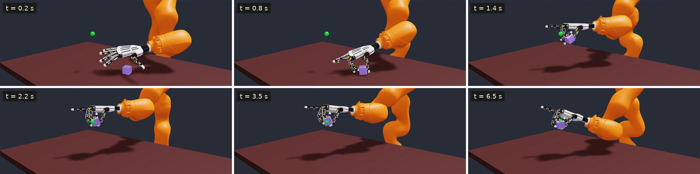

# Kuka iiwa 7 + cable-driven hand: lift a cube

The cable-driven hand of Newton's
[`exp/cable-driven-hand-series`](https://github.com/skulkar22/newton/tree/exp/cable-driven-hand-series)
branch (`newton.examples.cable.cable_hand`) on the KUKA LBR iiwa 7 of the Kuka-Allegro lift task
(`Isaac-Lift-KukaAllegro`), with a PPO policy that picks a cube up from the table and carries it to a
target in the air.



## What is simulated

| | Kuka-Allegro lift (`Isaac-Lift-KukaAllegro`) | This task |
|---|---|---|
| Arm | iiwa 7 from `Robots/KukaAllegro/kuka.usd`, PD joint drives | same USD (Allegro left out), prescribed joint trajectories |
| Hand | Allegro, 16 joint-position actuators | cable-driven hand: 15 flexion joints on 7 cables + thumb opposition hinge |
| Physics | MuJoCo-Warp (Newton) | VBD (Newton) with massless routed tendons |
| Scene | table top at 0.255 m, robot at the origin | same table, same layout |
| Object | 5 cm cube, 0.2 kg (default: procedural shapes) | 4 cm cube, 0.07 kg |
| Actions | relative joint targets for all 23 joints (scale 0.1) | relative arm joint targets (scale 0.1) + 7 cable tensions + opposition angle |
| Policy rate | 30 Hz | 30 Hz |
| Rewards | reaching, position progress, success, penalties | reaching, lifting, goal tracking (Isaac Lab lift recipe), penalties |
| Curriculum | ADR, gravity, spawn-in-hand reset bank | spawn-in-hand reset bank (scripted pinch) |

**The hand.** Five digits with three joints each, closed by cables and opened by preloaded return
springs. The index and middle fingers have two cables (a knuckle cable that bends the first joint and a
curl cable that runs to the fingertip), the ring finger, little finger and thumb one flexor each: seven
cables on seven linear actuators in the palm. Every actuator runs behind the governor of the branch
(force limit 60 N, rest tension 2 N, rate limit 30 mm/s). The thumb sits on a direct-drive opposition
hinge (0 to 130 deg). Only the pads (one capsule per phalanx and two on the palm) collide. All of this
comes unchanged from the branch: `add_hand_skeleton`, `add_hand_tendons`, `add_hand_pads`,
`create_actuator_governor`, `create_spring_preload` and the solver settings of
`make_tendon_hand_grasp_solver`. The hand is mounted in line with the iiwa flange (palm +x along the
flange axis, palmar side along link-7 -y), its wrist flange 71 mm from the link-7 frame (the Allegro
mount plane).

**The arm.** The links and the palm follow the forward kinematics of a joint reference that moves
toward the commanded target under the iiwa 7 speed limits (x0.5) and a 5 rad/s^2 acceleration limit,
the way the branch's grasp examples drive a kinematic wrist. This models a stiff position-controlled
industrial arm; the arm has no dynamics of its own and its links do not collide. A safety floor in the
driver refuses steps that would bring the palm pads, the palm origin or the wrist flange to the table
(a stronger-than-any-contact arm would otherwise crush the fingers into the table and past their stops).

**Physics settings.** The branch tunes the tendon hand at 20 substeps x 16 iterations per 60 Hz frame.
Training uses 10 substeps x 8 iterations, at most 8 capstan sweeps per iteration and a contact
stiffness of 2.5e4 N/m (instead of 1e5), about 10x cheaper per frame. With these settings the branch's
own scripted grasps still work (the kinematic wrist of `example_cable_driven_hand`, `--scene grasp`):

| Grasp plan of the branch | Lift in the hold (plan 100 mm), default settings | fast settings, 1e5 N/m | fast settings, 2.5e4 N/m |
|---|---|---|---|
| can (side power grasp) | 100.8 mm | can thrown out (unstable) | 101.0 mm |
| block (three-digit pinch) | 99.3 mm | 102.1 mm | 102.1 mm |

At 4096 environments the task runs at about 21,000 environment steps per second on one RTX PRO 6000
Blackwell (0.19 s per policy step, 4.7 s per PPO iteration of 24 steps); the cost is set by the number
of kernel launches per substep, so it is nearly flat from 1 to 4096 worlds.

**Resets.** All worlds are identical replicas. After 0.5 s of settling the complete per-world state is
captured once: body and joint state, governor and opposition state, the arm reference and every
per-tendon, per-tendon-link and per-segment array of the solver. A reset copies the capture back for the
selected worlds, clears the solver's rigid history (joint duals and penalties, contact warm start) and
the contact matching there, and draws a new cube pose (+-6 cm, any yaw) and lift target.
`SolverVBD.reset` refuses models with tendons (the branch rebuilds the solver per episode); the rigid
part of it is called with the tendon check bypassed and the tendon history comes from the capture.

**Spawn-in-hand curriculum.** At start-up every world runs a scripted pinch (the block pinch of the
branch's grasp plans: thumb opposed to 118 deg, index and middle knuckle cables at 45 N, curl cables at
12 N) on one of 8 cube poses and lifts the cube by 10 cm; the worlds that hold it (about half) are
captured a second time. `held_reset_fraction` (default 0.3) of the resets start from those states. A
policy trained without this curriculum learned to bring the pinch point to the cube but did not lift it
once in 106 iterations (10 M steps).

## Observations, actions, rewards

Observations (103): arm joint reference and its rate, the 15 flexion angles and the opposition angle,
slider travels and cable tensions, palm pose, index/middle/ring/little/thumb tip pads relative to the
cube, cube pose and velocity, cube relative to the pinch point, target and target relative to the cube,
last action.

Actions (15, in [-1, 1]): 7 relative arm joint targets (x0.1 rad), 7 cable tensions (2 N to 45 N; the
governor enforces the rate and force limits), thumb opposition (60 deg to 130 deg).

Rewards (each multiplied by the 1/30 s policy step): pinch point to cube `1 - tanh(d/0.1)` (1.0) and
`1 - tanh(d/0.02)` (1.0); index, middle and thumb pads to cube `1 - tanh(d/0.05)` (1.0); lifted by 4 cm
while between the pinch digits (15); goal tracking `1 - tanh(d/0.3)` (16) and `1 - tanh(d/0.05)` (5)
while lifted; action rate (-1e-3); arm joint speed (-1e-3); palm pads below the table top (-200 per m);
early termination (-10). Episodes last 7 s and end early when the cube leaves the table, a flexion joint
is pushed more than 0.15 rad out of its range, or the state is not finite. Success: cube within 5 cm
of the target.

## Running

The branch pins Newton to the cable-driven hand commit (`pyproject.toml`, `uv.lock`):

```bash
uv sync
# train (4096 environments, about 2.6 h for 2000 iterations)
.venv/bin/python -m isaaclab_tasks.contrib.kuka_cable_hand.train --num_envs 4096 --max_iterations 2000
# evaluate 1024 episodes and record a video of 4 environments (needs an X display for the GL viewer)
DISPLAY=:0 .venv/bin/python -m isaaclab_tasks.contrib.kuka_cable_hand.play \
    --checkpoint logs/rsl_rl/kuka_cable_hand_lift/<run> --eval_envs 1024 --video lift.mp4 --video_envs 4
```

Run the scripts with the environment's Python directly; `uv run` re-syncs the environment first.

## Results

RESULTS_PLACEHOLDER

## Limitations

- The arm is prescribed (kinematic). Contact cannot push it back, so the safety floor keeps the palm
  above the table; the fingers may touch the table, and a digit pushed far past its stop ends the episode.
- When a digit is crushed the solver can report that a cable crossed the supported wrap range of a
  sheave (`ERROR: Tendon ... crossed the supported wrap range`). These messages appear while the policy
  still flails; `train.py` output can be filtered to count them.
- The fast solver settings are validated on the branch's scripted can and block grasps, not on the
  hand calculation the branch checks its digits against (0.07 deg at 20 x 16).
- Only the massless-tendon cable model is used; the rod cable model is far more expensive.
- The task is a Newton-native vectorized environment with the `rsl_rl` `VecEnv` interface, placed in
  `isaaclab_tasks.contrib` and built on the Kuka-Allegro asset; it is not an Isaac Lab
  `ManagerBasedRLEnv`/`DirectRLEnv`. The hand is built procedurally by the branch's helpers rather than
  from USD, and a per-world reset needs the solver's tendon history restored, which Isaac Lab's Newton
  scene path (USD cloner, `NewtonManager`) has no hook for. Porting it means adding the hand through
  `newton_builder_world_hook`, the governor and opposition drive as state-force callbacks, and the
  tendon reset to the environment's `_reset_idx`.
